# DỰ BÁO TỐC ĐỘ GIAO THÔNG BẰNG GRU VÀ T-GCN: TÁI LẬP, PHẢN BIỆN VÀ CẢI TIẾN

*Bài tập lớn Khai phá dữ liệu — Đề tài: Dự báo tốc độ giao thông dựa trên mô hình GRU và T-GCN (Los-loop, SZ-taxi). Mọi số liệu trong báo cáo được sinh tự động từ thí nghiệm thật trong thư mục `results/` và `reports/tables/`; không có con số nào được ước đoán.*

## Tóm tắt

Chúng tôi cài đặt lại GRU, GCN và T-GCN (Zhao et al., 2019) bằng PyTorch, chạy trên dữ liệu thật Los-loop (207 cảm biến, 7 ngày, 5 phút/mốc) và SZ-taxi (156 tuyến, 31 ngày, 15 phút/mốc) với **cùng dữ liệu, cùng cách chia train/validation/test theo thời gian (70/10/20), 3 seed**, kèm 4 baseline cổ điển (persistence, HA, HA theo giờ, hồi quy tuyến tính). Thực nghiệm đi theo ba giai đoạn của đề tài: (1) GRU và kiểm tra dữ liệu, (2) T-GCN cùng điều kiện, (3) so sánh sai số, phân tích giờ cao điểm và thử cải tiến (cửa sổ đầu vào, số hidden units, đặc trưng thời gian, residual, ...). Kết quả chính trên Los-loop:

1. **GRU tái lập đúng bài báo** (RMSE "15 phút" 5.217 so với 5.218 của bài báo), **T-GCN thì không vượt GRU**: RMSE TB 12 tầm 7.516 ± 0.031 so với 7.495 ± 0.006 (Diebold–Mariano p = 0.76), MAE kém hơn (4.37 so với 4.18). Đồ thị chỉ có lợi ở tầm 45–60 phút, khi tốc độ biến động mạnh và khi dữ liệu nhiễu.
2. **Cơ chế:** chuẩn hóa D^(-1/2)(A+I)D^(-1/2) chỉ để lại ~30% trọng số cho tín hiệu của chính nút ⇒ T-GCN dự báo tầm ngắn kém cả persistence (5 phút: RMSE 4.84 so với 4.45). Ba bằng chứng độc lập: thí nghiệm liều–đáp ứng với trọng số self-loop, permutation importance, gradient saliency. Khi tách riêng trọng số "bản thân / láng giềng" ([x, Âx]W), T-GCN tốt hơn GRU.
3. **Phản biện bài báo:** chọn epoch bằng tập test (đo được độ lạc quan 0.5%, tối đa 1.7% — cùng cỡ lợi thế T-GCN báo cáo), "15/30/45/60 phút" là sai số gộp các bước, không có baseline persistence (persistence có MAE "15 phút" 3.16 < 3.18 của T-GCN), không có độ biến thiên, kết luận "tốt nhất trên mọi chỉ số" mâu thuẫn với MAE trong chính Bảng 1.
4. **Giờ cao điểm là điểm yếu chung:** trong cao điểm và khi kẹt xe, persistence có MAE thấp nhất; mọi mô hình học sâu dự báo lạc quan ~9 mph khi tốc độ ≤ 20 mph; khoảng dự báo conformal 90% chỉ phủ 69–79% trong cao điểm.
5. **Cải tiến hiệu quả nhất là cách đặt bài toán, không phải đồ thị:** học phần thay đổi (residual) + đặc trưng giờ/thứ + loss theo đơn vị gốc. GRU-RT giảm RMSE 6.9% so với GRU (p < 0.001); ensemble 3 seed đạt "15 phút" 5.09 / 3.01 và "60 phút" 6.91 / 4.01 — tốt hơn mọi con số của bài báo (T-GCN: 5.13 / 3.18 và 7.27 / 4.60) dù dùng giao thức chặt hơn. Siêu tham số (cửa sổ 6–24 bước, hidden 32–100) chỉ thay đổi kết quả ≤ 1.3%.
6. **Độ tin cậy:** kết quả rất ổn định theo seed (CV ≤ 1%); nhưng mô hình residual rất nhạy với cảm biến hỏng (5% đầu vào = 0 làm RMSE tăng 30–60%) ⇒ cần bước kiểm tra dữ liệu khi triển khai.

SUMMARY_SZ

**Mục lục:** 1. Ý tưởng · 2. Dữ liệu & kiểm tra dữ liệu · 3. Phương pháp · 4. Phản biện bài báo · 5. Kết quả 3 giai đoạn · 6. Mô hình huấn luyện được & cách dùng · 7. Minh chứng – giải thích cơ chế · 8. Độ tin cậy · 9. So sánh với bài báo · 10. SZ-taxi · 11. Hạn chế & hướng phát triển · 12. Kết luận


## 1. Ý tưởng

**Bài toán.** Cho tốc độ quan sát được tại N cảm biến (Los-loop: 207 vòng từ trên cao tốc Los Angeles, 5 phút/mốc; SZ-taxi: 156 tuyến đường quận La Hồ – Thâm Quyến, 15 phút/mốc) trong L bước gần nhất, dự báo tốc độ của **toàn bộ mạng** trong H bước tiếp theo (15, 30, 45, 60 phút).

**Ý tưởng của T-GCN (Zhao et al., 2019).** Tốc độ ở một đoạn đường phụ thuộc vào (i) chính quá khứ của nó (phụ thuộc thời gian) và (ii) trạng thái các đoạn đường lân cận (phụ thuộc không gian: ùn tắc lan truyền ngược dòng). GRU mô hình hóa (i); GCN mô hình hóa (ii). T-GCN đặt GCN **vào bên trong các cổng của GRU**: ở mỗi bước, trước khi quyết định "nhớ" hay "ghi đè", mỗi nút tổng hợp thông tin của các nút kề.

**Câu hỏi nghiên cứu của đồ án.** Chúng tôi không chỉ chạy lại mà kiểm chứng bốn giả thuyết:

- **H1 – Đồ thị có ích:** T-GCN tốt hơn GRU (cùng dữ liệu, cùng chia tập, cùng seed).
- **H2 – Học sâu có ích:** GRU/T-GCN tốt hơn các baseline đơn giản, kể cả baseline "giữ nguyên giá trị cuối" (persistence) mà bài báo không so sánh.
- **H3 – Con số của bài báo đáng tin:** giao thức đánh giá của tác giả không làm lạc quan kết quả.
- **H4 – Có thể cải tiến:** điều chỉnh cửa sổ đầu vào, số hidden units, thêm đặc trưng thời gian và học phần thay đổi (residual) giúp giảm sai số, nhất là giờ cao điểm.

## 2. Dẫn dắt — dữ liệu và kiểm tra dữ liệu (giai đoạn 1)

### 2.1 Tổng quan hai bộ dữ liệu

| Thuộc tính | Los-loop | SZ-taxi |
|---|---|---|
| Số mốc × số nút | 2016 × 207 | 2976 × 156 |
| Bước thời gian | 5 phút | 15 phút |
| Khoảng thời gian | 01/03/2012 (thứ Năm) → 07/03/2012 | 01/01/2015 → 31/01/2015 |
| Tốc độ TB ± độ lệch chuẩn | 58.9 ± 12.5 (mph) | 12.2 ± 12.7 |
| Giá trị 0 | 0% | **24.8%** (37 tuyến có > 50% là 0) |
| Đồ thị | 2626 cạnh, bậc TB 12.7, đối xứng, có trọng số theo khoảng cách | 532 cạnh, bậc TB 3.4, **có hướng**, nhị phân |
| Train / Val / Test (70/10/20 theo thời gian) | đến 05/03 21:35 / đến 06/03 14:20 / phần còn lại | đến 22/01 16:45 / đến 25/01 19:00 / phần còn lại |

Dữ liệu không có cột thời gian; chúng tôi dựng mốc thời gian từ ngày bắt đầu theo bài báo. **Kiểm chứng**: hồ sơ tốc độ trung bình theo giờ (Hình 1) cho thấy Los-loop có hai đáy rõ rệt lúc 7–9h và 16–19h vào ngày thường, còn cuối tuần gần như không có — đúng với giờ cao điểm địa phương, nên mốc thời gian dựng lại là hợp lệ và các đặc trưng giờ/thứ có nghĩa.

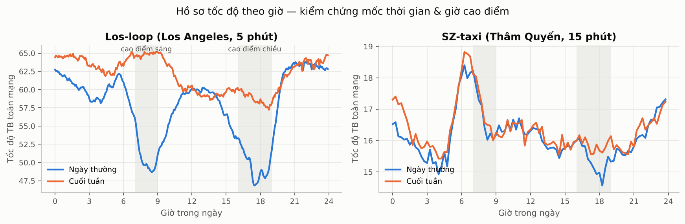

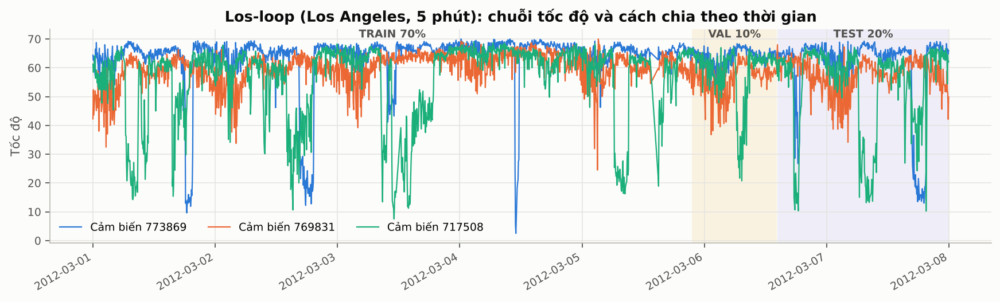

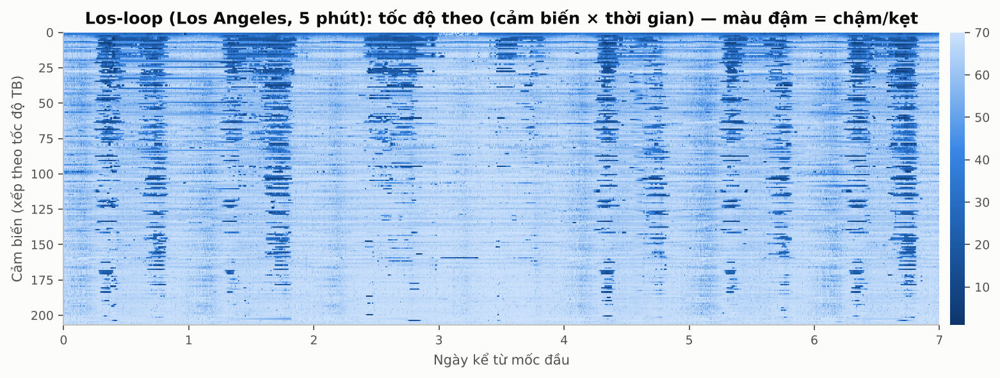

### 2.2 Bằng chứng cho phụ thuộc thời gian và không gian

- **Thời gian (Hình 4):** tự tương quan trung bình của Los-loop là 0.82 ở độ trễ 5 phút, 0.74 ở 15 phút và còn 0.50 ở 60 phút ⇒ cửa sổ 12 bước (60 phút) chứa phần lớn thông tin hữu ích; thông tin gần nhất quan trọng nhất. SZ-taxi chỉ 0.41 ở 15 phút và giảm rất chậm ⇒ chuỗi rất **nhiễu** (tốc độ ước lượng từ một số ít taxi), trung bình trượt sẽ là baseline mạnh.
- **Không gian (Hình 5):** hệ số tương quan giữa hai cảm biến giảm theo khoảng cách trên đồ thị: Los-loop 0.41 (kề trực tiếp) → 0.24 (2 bước) → 0.11 (≥ 10 bước). Đây là cơ sở cho GCN. Tuy nhiên, tương quan của **biến động ngắn hạn** (Δ tốc độ 5 phút) giữa hai nút kề chỉ 0.066 (và ≈ 0 với nút xa): láng giềng cho biết "mức" tốc độ chung của khu vực, nhưng rất ít thông tin về cú sốc kế tiếp. Ta kỳ vọng lợi ích của đồ thị là **có nhưng nhỏ** ở tầm ngắn.

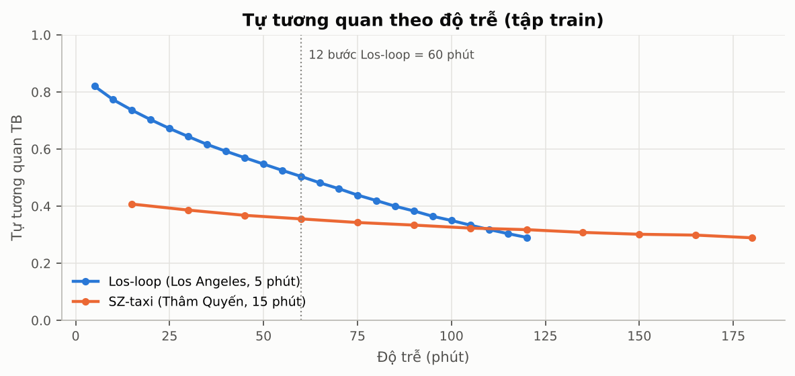

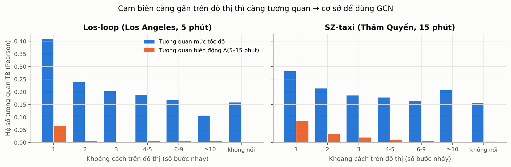

### 2.3 Chất lượng dữ liệu — những điều bài báo không nói

1. **Los-loop chỉ có 7 ngày.** Tập train chứa 5 ngày (trong đó có 2 ngày cuối tuần), tức chỉ khoảng 3 lần quan sát mỗi khung giờ cao điểm ngày thường. Mọi mô hình học "theo giờ" đều có nguy cơ quá khớp.
2. **Dữ liệu nội suy.** Bài báo cho biết đã nội suy tuyến tính chỗ thiếu. Chúng tôi phát hiện 3.5% điểm nằm trên các đoạn thẳng tuyệt đối (≥ 6 điểm thẳng hàng), trong đó có một sự cố **mất dữ liệu toàn mạng** ngày 05/03 từ 13:30 đến 14:55 (100% cảm biến bị nội suy). Tập test có 4.6% mục tiêu như vậy; dự báo "trơn" sẽ được thưởng một cách giả tạo trên các điểm này (kiểm tra ở mục 8.5).
3. **SZ-taxi: số 0 nghĩa là "không có dữ liệu".** 24.8% giá trị bằng 0; tỉ lệ 0 cao nhất lúc 5–7h sáng (khi ít taxi), không phải giờ cao điểm. Đó là thiếu quan sát chứ không phải kẹt xe (Hình 6). Bài báo vẫn huấn luyện và chấm điểm trên các số 0 này. Chúng tôi báo cáo cả hai cách chấm (gồm 0 – để so với bài báo, và bỏ 0 – có ý nghĩa thực tế).

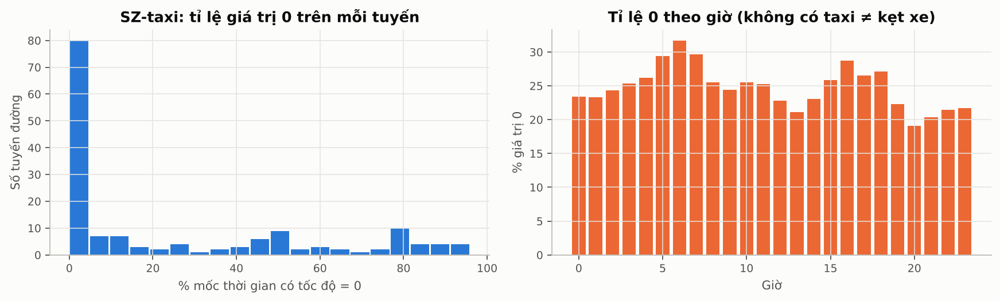


## 3. Phương pháp

### 3.1 Các mô hình

Ký hiệu: x_t ∈ R^N là tốc độ (đã chuẩn hóa z-score theo từng cảm biến, thống kê **chỉ lấy từ train**) tại bước t; A là ma trận kề; Â = D̃^(-1/2)(A + I)D̃^(-1/2) là ma trận kề chuẩn hóa đối xứng (SZ-taxi có hướng được đối xứng hóa A ← max(A, Aᵀ)).

| Mô hình | Mô tả | Thông tin dùng |
|---|---|---|
| Naive (persistence) | ŷ_{t+k} = x_t | chỉ giá trị cuối |
| HA (trung bình cửa sổ) | ŷ_{t+k} = trung bình L bước vào — đúng như "HA" của tác giả (giống nhau ở mọi tầm) | thời gian |
| HA theo giờ | trung bình cùng khung giờ trên các ngày train | lịch |
| Hồi quy tuyến tính | ridge trên L độ trễ, dùng chung cho mọi nút (tương đương SVR tuyến tính của bài báo) | thời gian (tuyến tính) |
| GCN | 2 lớp GCN, L độ trễ là đặc trưng của nút, không có trạng thái hồi quy | không gian |
| GRU | một GRU dùng chung trọng số cho mọi nút, không trao đổi giữa các nút | thời gian |
| **T-GCN** | GRU mà mọi phép tuyến tính trong cổng được thay bằng GCN (công thức dưới) | không gian + thời gian |

Ô T-GCN (cùng cấu trúc với mã TensorFlow của tác giả: một lớp GCN trong mỗi cổng, bias cổng khởi tạo 1.0):

```
u_t = σ( Â [x_t , h_{t-1}] W_u + b_u )          cổng cập nhật (giữ bộ nhớ bao nhiêu)
r_t = σ( Â [x_t , h_{t-1}] W_r + b_r )          cổng reset
c_t = tanh( Â [x_t , r_t ⊙ h_{t-1}] W_c + b_c )  trạng thái ứng viên
h_t = u_t ⊙ h_{t-1} + (1 − u_t) ⊙ c_t
ŷ_{t+1..t+H} = h_L W_out + b_out                 (một đầu ra tuyến tính cho H bước, dự báo trực tiếp)
```

GRU baseline chính là ô trên với  = I. Vì vậy so sánh GRU ↔ T-GCN cô lập đúng một yếu tố: **có hay không trộn thông tin láng giềng**.

### 3.2 Các cải tiến được thử (giai đoạn 3)

| Ký hiệu | Thay đổi | Lý do (giả thuyết) |
|---|---|---|
| `+time` | nối sin/cos(giờ trong ngày), sin/cos(thứ trong tuần) vào đầu vào mỗi nút | giờ cao điểm lặp lại hằng ngày; GRU 12 bước không "biết" bây giờ là mấy giờ |
| `+res` (residual) | ŷ_{t+k} = x_t + Δ̂_k: mạng chỉ học **phần thay đổi** so với giá trị cuối | persistence đã rất mạnh ở tầm ngắn; Â làm loãng tín hiệu của chính nút (mục 5.3) |
| **T-GCN-RT** | T-GCN + time + res | kết hợp hai ý trên |
| `selfsep` | GCN dạng [x, Âx]W: trọng số riêng cho bản thân và láng giềng | giữ 100% tín hiệu của chính nút (như số hạng k = 0 của DCRNN) |
| T-GCN+ | RT + đồ thị thích nghi học từ embedding nút | bắt quan hệ không có trong đồ thị vật lý |
| Huber | hàm mất mát Smooth-L1 thay MSE | bền với ngoại lai, nhắm MAE |
| cửa sổ L, hidden | L ∈ {6, 12, 24}, hidden ∈ {32, 64, 100} | theo yêu cầu đề tài |
| Ensemble | trung bình dự báo của 3 seed | giảm phương sai, tăng độ tin cậy |

### 3.3 Thiết kế thực nghiệm (giao thức "nghiêm ngặt")

- **Chia theo thời gian 70/10/20** (train/validation/test), không xáo trộn; chuẩn hóa bằng thống kê của train; ngữ cảnh đầu vào của mẫu test được phép lấy từ quá khứ (val), nhưng **mục tiêu** luôn nằm trong 20% cuối.
- Đầu vào L = 12 bước (Los-loop: 60 phút; SZ-taxi: 3 giờ); dự báo trực tiếp H = 12 bước (Los-loop, 5…60 phút) hoặc H = 4 (SZ-taxi, 15…60 phút). Một mô hình cho mọi tầm.
- Huấn luyện: AdamW, lr 2·10⁻³ giảm dần kiểu cosine đến 10⁻⁴, weight decay 10⁻⁴, batch 32, tối đa 120 epoch, **dừng sớm theo MSE trên validation** (patience 20), cắt gradient 5. Hàm mất mát MSE cho mọi mô hình (Huber chỉ là biến thể).
- **3 seed** (42, 123, 2026) cho các mô hình chính và T-GCN-RT; báo cáo trung bình ± độ lệch chuẩn. Biến thể phụ và tinh chỉnh: 1 seed (42).
- Đánh giá: RMSE, MAE, MAPE (chỉ |y| ≥ 5), WAPE và ba chỉ số của bài báo (Accuracy, R², Var). Sai số được tính **tại đúng bước k** ("per-step"); để so với bài báo, chúng tôi tính thêm kiểu của tác giả: gộp mọi bước 1..k ("cumulative").
- Để đo độ lạc quan của giao thức tác giả, mỗi run ghi lại RMSE test ở mọi epoch (**chỉ ghi, không dùng để chọn**).
- Phần cứng: CPU 4 nhân, không GPU (≈ 15–25 giây/epoch cho T-GCN, 4 run song song).


## 4. Phản biện bài báo

Các điểm dưới đây được kiểm chứng trực tiếp từ Bảng 1 của bài báo và mã nguồn chính thức (`lehaifeng/T-GCN/T-GCN/T-GCN-TensorFlow/main.py`, `input_data.py`), không phải suy đoán.

**P1. Chọn epoch theo tập test.** Mã của tác giả đánh giá tập test sau *mỗi* epoch và báo cáo kết quả ở epoch có RMSE test nhỏ nhất:
```python
index = test_rmse.index(np.min(test_rmse))      # main.py, dòng cuối
print('min_rmse:%r' % (np.min(test_rmse)), 'min_mae:%r' % (test_mae[index]), ...)
```
Không có tập validation. Đây là rò rỉ thông tin từ test vào lựa chọn mô hình: con số báo cáo là *cận dưới lạc quan*, không phải sai số kỳ vọng trên dữ liệu mới. Chúng tôi đo trực tiếp độ lạc quan này ở mục 4.1.

**P2. Chuẩn hóa bằng giá trị lớn nhất của toàn bộ chuỗi** (`max_value = np.max(data1)` trước khi chia train/test) — một thống kê của tập test được dùng khi huấn luyện. Ảnh hưởng nhỏ (Los-loop max = 70 ở cả train lẫn test) nhưng sai về nguyên tắc.

**P3. Cách gộp sai số theo tầm dự báo.** Mã tác giả làm phẳng mọi bước đầu ra (`reshape(test_output, [-1, num_nodes])`) trước khi tính chỉ số, nên "15 phút" trên Los-loop thực chất là **trung bình của 5, 10 và 15 phút**, "60 phút" là trung bình của 12 bước. Con số vì thế dễ hơn sai số thật tại đúng thời điểm 60 phút: với GRU của chúng tôi, RMSE tại đúng bước 60 phút là 9.32 nhưng kiểu gộp của bài báo chỉ 7.50 (thấp hơn 20%).

**P4. Thiếu baseline persistence.** Baseline "giữ nguyên giá trị cuối" (ŷ_{t+k} = x_t) không cần học gì, là thước đo tối thiểu trong dự báo giao thông. Trên Los-loop, dùng **đúng cửa sổ test và cách gộp của tác giả** (80/20, cửa sổ nằm trọn trong 20% cuối), persistence đạt **MAE 3.16 ở "15 phút" — tốt hơn MAE 3.18 của T-GCN** trong bài báo; ở "60 phút" persistence có MAE 4.43 so với 4.60 của T-GCN (RMSE thì T-GCN tốt hơn: 5.13 so với 5.54 và 7.27 so với 8.46). Bài báo kết luận T-GCN vượt HA, ARIMA, SVR nhưng không cho thấy nó vượt được mức tối thiểu này theo MAE.

**P5. Kết luận không khớp với chính bảng số liệu.** Bài báo viết: *"the T-GCN model obtains the best prediction performance under all evaluation metrics for all prediction horizons"*. Nhưng trong Bảng 1, **MAE của GRU thấp hơn T-GCN ở cả 8 ô** (Los-loop: 3.06 < 3.18; 3.65 < 3.75; 4.09 < 4.12; 4.52 < 4.60 — SZ-taxi: 2.68 < 2.71; 2.70 < 2.75; 2.72 < 2.77; 2.74 < 2.79). T-GCN chỉ tốt hơn theo RMSE. Mục 5.3 giải thích cơ chế dẫn đến hiện tượng này.

**P6. "Không nhạy với tầm dự báo" là tính chất của dữ liệu, không phải của mô hình.** Trên SZ-taxi, RMSE của T-GCN chỉ tăng từ 3.92 (15 phút) lên 4.01 (60 phút). Nhưng chính trung bình trượt 3 giờ (HA cửa sổ) cũng gần như phẳng (4.16 → 4.31 trong thực nghiệm của chúng tôi): chuỗi SZ-taxi nhiễu và gần như dừng ở độ phân giải 15 phút, nên tầm dự báo ít quan trọng với *mọi* mô hình.

**P7. Một lần chạy, không có độ biến thiên.** Bảng 1 không có độ lệch chuẩn hay kiểm định. Khi chênh lệch giữa GRU và T-GCN chỉ khoảng 1–3%, không thể biết nó có vượt nhiễu do khởi tạo ngẫu nhiên hay không (mục 8).

**P8. Dữ liệu.** Los-loop chỉ dài 7 ngày và chứa đoạn nội suy (gồm một lần mất dữ liệu toàn mạng); SZ-taxi có 24.8% giá trị 0 vốn là thiếu quan sát nhưng vẫn được dùng làm mục tiêu (mục 2.3).

### 4.1 Đo trực tiếp độ lạc quan của việc chọn epoch theo test

Mỗi run của chúng tôi ghi lại RMSE test ở *mọi* epoch (chỉ ghi, không dùng để chọn). So sánh RMSE test tại epoch có validation tốt nhất (cách đúng) với RMSE test nhỏ nhất qua mọi epoch (cách của tác giả):

| Mô hình | run | RMSE test – chọn theo val | RMSE test – chọn theo test | độ lạc quan TB | tối đa | epoch (val / test) |
|---|---|---|---|---|---|---|
| GCN | 3 | 8.606 | 8.579 | 0.32% | 0.37% | 105 / 73 |
| GRU | 3 | 7.495 | 7.466 | 0.38% | 0.41% | 94 / 74 |
| T-GCN | 3 | 7.516 | 7.476 | 0.54% | 0.77% | 80 / 57 |
| GRU-RT (GRU + residual + thời gian) | 3 | 6.981 | 6.936 | 0.64% | 1.72% | 30 / 20 |
| T-GCN-RT (residual + thời gian) | 3 | 7.375 | 7.319 | 0.76% | 1.22% | 31 / 36 |
| T-GCN-RT tách self/láng giềng (T-GCN-RTS) | 1 | 7.172 | 6.974 | 2.76% | 2.76% | 18 / 7 |

Chọn theo test làm sai số đẹp hơn trung bình 0.65% (tối đa 2.76%). Con số nghe nhỏ, nhưng **cùng cỡ với toàn bộ lợi thế mà bài báo báo cáo cho T-GCN so với GRU** trên Los-loop (RMSE "15 phút" 5.13 so với 5.22, tức 1.8%). Mục 9.2 tái lập nguyên vẹn giao thức của tác giả để so sánh trực tiếp.


## 5. Kết quả thực nghiệm trên Los-loop

Mọi con số dưới đây là trên **tập test** (20% cuối, 06/03 14:20 → 07/03 23:55), sai số tại đúng bước k (per-step) trừ khi ghi "kiểu bài báo"; "TB 12 tầm" là sai số gộp mọi bước 5…60 phút. Mô hình có 3 seed được ghi trung bình ± độ lệch chuẩn.

### 5.1 Giai đoạn 1 — GRU: kết quả ban đầu

GRU (hidden 64, L = 12) hội tụ ổn định (dừng sớm ở epoch 87–101) và **rất ít phụ thuộc seed**: RMSE TB 12 tầm = 7.495 ± 0.006, MAE = 4.175 ± 0.023. Tính theo đúng cách của bài báo, GRU của chúng tôi đạt RMSE 5.217 / MAE 2.965 ở "15 phút" và 7.495 / 4.175 ở "60 phút" — **khớp gần như tuyệt đối** với GRU trong Bảng 1 của bài báo (5.218 / 3.060 và 7.662 / 4.519), dù chúng tôi train trên ít dữ liệu hơn (70% so với 80%) và chọn epoch bằng validation. Kết luận giai đoạn 1: pipeline dữ liệu, chuẩn hóa và đánh giá là đúng; GRU là baseline đáng tin cậy và **vượt persistence ở mọi tầm** (skill +9% ở 5 phút, +26% ở 60 phút).

### 5.2 Giai đoạn 2 — T-GCN trên cùng dữ liệu, cùng cách chia

| Mô hình (3 seed) | RMSE TB 12 tầm | MAE TB 12 tầm | 5 phút | 15 phút | 30 phút | 60 phút |
|---|---|---|---|---|---|---|
| Naive (persistence) | 8.418 | 4.408 | 4.45 / 2.69 | 6.45 / 3.56 | 8.22 / 4.37 | 10.85 / 5.77 |
| GCN | 8.606 ± 0.009 | 5.345 ± 0.009 | 7.42 / 4.61 | 7.85 / 4.89 | 8.48 / 5.30 | 9.69 / 6.04 |
| GRU | 7.495 ± 0.006 | **4.175 ± 0.023** | **4.23 / 2.53** | **6.00 / 3.36** | 7.44 / 4.18 | 9.32 / 5.38 |
| T-GCN | 7.516 ± 0.031 | 4.371 ± 0.037 | 4.84 / 3.03 | 6.16 / 3.67 | 7.47 / 4.36 | **9.13** / 5.39 |

*(ô "5 phút … 60 phút" = RMSE / MAE tại đúng bước đó)*

Ba quan sát:

1. **T-GCN không tốt hơn GRU tổng thể.** Chênh lệch RMSE +0.02 (KTC 95% bootstrap khối [−0.12; +0.15], kiểm định Diebold–Mariano p = 0.76) — không có ý nghĩa thống kê; MAE thì GRU tốt hơn rõ (4.18 so với 4.37). Điều này **trùng khớp với Bảng 1 của chính bài báo**, nơi MAE của GRU thấp hơn T-GCN ở cả 8 ô (mục 4, P5).
2. **Có điểm giao nhau theo tầm dự báo:** ở tầm ngắn T-GCN kém GRU rõ (5 phút: 4.84 so với 4.23 — kém cả persistence 4.45), nhưng ở 45–60 phút T-GCN tốt hơn (60 phút: 9.13 so với 9.32). Thông tin láng giềng có ích để dự báo xa (ùn tắc lan truyền) nhưng làm hại dự báo gần — mục 7.3 giải thích cơ chế.
3. **Cách chuẩn hóa đồ thị quyết định T-GCN tốt hay tệ.** Phiên bản đầu của dự án đặt đường chéo  = 1 (không cộng thêm I như mã tác giả) cho T-GCN RMSE 7.93 / MAE 4.74 (5 phút: 5.96!). Chỉ riêng việc tăng trọng số tự thân (self-loop = 2, đúng như mã gốc) đã đưa T-GCN về 7.52 / 4.37. Đây là bằng chứng trực tiếp đầu tiên cho giả thuyết "loãng tín hiệu của chính nút".

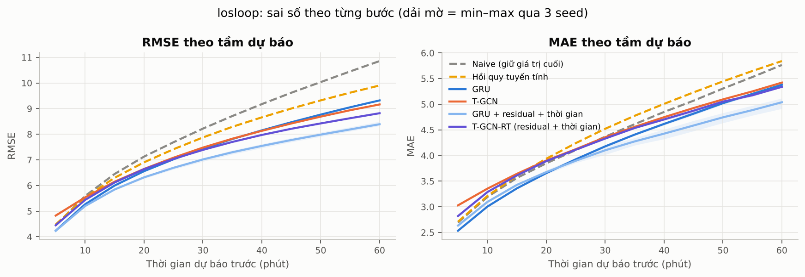

### 5.3 Giai đoạn 3 — So sánh sai số và phân tích giờ cao điểm

**Sai số tập trung vào giờ cao điểm.** Giờ cao điểm ngày thường (7–9h, 16–19h) chiếm 24% mục tiêu của tập test nhưng MAE ở đó cao gấp 1.4–2 lần ngoài cao điểm (Hình 8). Bảng dưới tách tập test theo trạng thái giao thông (MAE, trung bình 3 seed):

**MAE – dự báo trước 15 phút**

| Mô hình | tất cả | ngoài cao điểm | cao điểm | thông thoáng | kẹt xe (v<40) | biến động mạnh (Δ>10) |
|---|---|---|---|---|---|---|
| Naive (giữ giá trị cuối) | 3.562 | 3.355 | 4.203 | 3.048 | 6.950 | — |
| Hồi quy tuyến tính | 3.607 | 3.180 | 4.931 | 2.782 | 9.050 | — |
| GRU | 3.359 | 3.004 | 4.456 | 2.635 | 8.135 | — |
| T-GCN | 3.642 | 3.150 | 5.165 | 2.887 | 8.624 | — |
| GRU-RT (GRU + residual + thời gian) | 3.439 | 3.093 | 4.510 | 2.821 | 7.518 | — |
| T-GCN-RT (residual + thời gian) | 3.611 | 3.236 | 4.772 | 2.887 | 8.388 | — |

**MAE – dự báo trước 60 phút**

| Mô hình | tất cả | ngoài cao điểm | cao điểm | thông thoáng | kẹt xe (v<40) | biến động mạnh (Δ>10) |
|---|---|---|---|---|---|---|
| Naive (giữ giá trị cuối) | 5.765 | 5.223 | 7.441 | 4.592 | 13.580 | — |
| Hồi quy tuyến tính | 5.842 | 4.727 | 9.289 | 3.919 | 18.652 | — |
| GRU | 5.379 | 4.358 | 8.537 | 3.641 | 16.959 | — |
| T-GCN | 5.421 | 4.384 | 8.631 | 3.817 | 16.114 | — |
| GRU-RT (GRU + residual + thời gian) | 5.085 | 4.111 | 8.098 | 3.764 | 13.892 | — |
| T-GCN-RT (residual + thời gian) | 5.339 | 4.437 | 8.127 | 4.017 | 14.147 | — |

*Tỉ lệ mẫu test: ngoài cao điểm 76%, cao điểm 24%, thông thoáng 87%, kẹt xe (v<40) 13%, biến động mạnh (Δ>10) nan%.*

Những điều bảng này cho thấy — và bài báo không phân tích:

- **Trong giờ cao điểm và khi kẹt xe (v < 40 mph), persistence có MAE thấp nhất ở cả 15 lẫn 60 phút.** Mô hình học sâu thắng tổng thể chủ yếu nhờ 76% thời gian ngoài cao điểm, nơi chúng làm trơn tốt dao động nhỏ.
- **Khi tốc độ biến động mạnh (|Δ| > 10 mph so với giá trị cuối, 7% mẫu), T-GCN tốt nhất ở 15 phút** (MAE 14.2 so với 15.6 của GRU và 18.6 của persistence): láng giềng phía trước "báo trước" cú sốc. Đây là nơi duy nhất đồ thị tạo khác biệt rõ ở tầm ngắn.
- Mọi mô hình học sâu **dự báo lạc quan khi kẹt xe**: với tốc độ thực ≤ 20 mph, sai số trung bình (bias) là +9 mph (Hình 13) — hệ quả của hàm mất mát MSE (dự báo kỳ vọng có điều kiện, kéo về mức thông thoáng chiếm đa số).

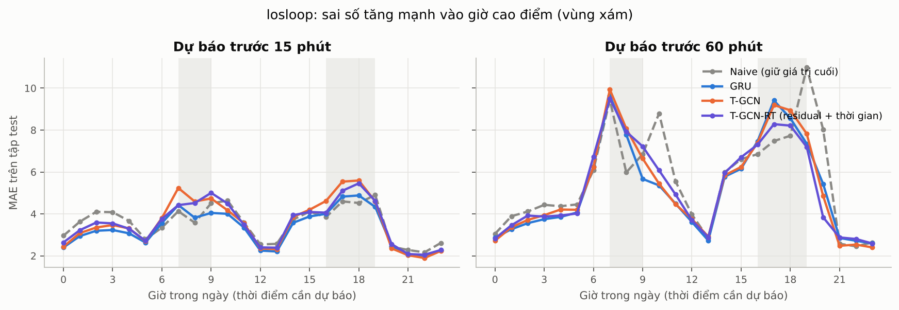

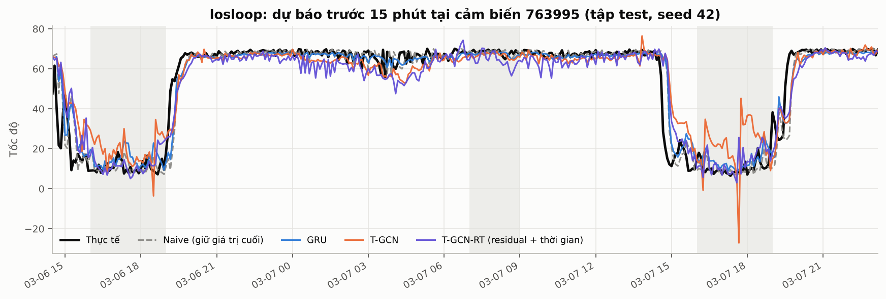

Hình 9 cho thấy thêm: mọi mô hình đều "trễ" khoảng một tầm dự báo khi kẹt xe bắt đầu (không thể biết trước một sự kiện chưa có dấu hiệu trong 60 phút đầu vào), và T-GCN gốc cho cả dự báo **phi vật lý** (tốc độ âm tới −27 mph) vì đầu ra tuyến tính không bị chặn.

### 5.4 Giai đoạn 3 — Thử cải thiện: cửa sổ đầu vào, hidden units, đặc trưng thời gian, residual

Theo yêu cầu đề tài, chúng tôi thử ba "núm vặn" trên T-GCN: độ dài cửa sổ đầu vào, số hidden units và đặc trưng thời gian; sau đó thử thêm các thay đổi về *cách đặt bài toán* (residual, hàm mất mát) và về *cách dùng đồ thị*. Tinh chỉnh dùng seed 42 (so với cấu hình mặc định cùng seed).

**Cửa sổ đầu vào và số hidden units:**

| Cấu hình (seed 42) | tham số | RMSE TB | MAE TB | 15 phút | 60 phút | epoch chọn | thời gian train (phút) |
|---|---|---|---|---|---|---|---|
| T-GCN, L = 12, hidden = 64 (mặc định) | 13,452 | 7.482 | 4.336 | 6.15 / 3.65 | 9.07 / 5.35 | 65 | 20 |
| T-GCN, L = 6 (30 phút) | 13,452 | 7.578 | 4.451 | 6.14 / 3.68 | 9.29 / 5.56 | 105 | 25 |
| T-GCN, L = 24 (120 phút) | 13,452 | 7.483 | 4.404 | 6.17 / 3.72 | 9.02 / 5.38 | 47 | 35 |
| T-GCN, hidden = 32 | 3,660 | 7.466 | 4.370 | 6.14 / 3.67 | 9.08 / 5.38 | 117 | 15 |
| T-GCN, hidden = 100 | 31,812 | 7.533 | 4.431 | 6.16 / 3.68 | 9.17 / 5.53 | 56 | 35 |
| T-GCN-RT, L = 12 | 14,220 | 7.350 | 4.324 | 6.13 / 3.61 | 8.83 / 5.35 | 33 | 13 |
| T-GCN-RT, L = 6 | 14,220 | 7.272 | 4.382 | 6.03 / 3.63 | 8.80 / 5.48 | 55 | 10 |
| T-GCN-RT, L = 24 | 14,220 | 7.526 | 4.384 | 6.15 / 3.62 | 9.12 / 5.44 | 35 | 27 |

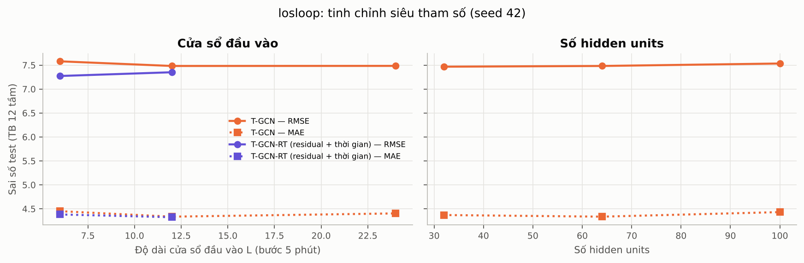

- **Cửa sổ L:** với T-GCN gốc, L = 6 (30 phút) kém hơn L = 12 (RMSE 7.58 so với 7.48, chủ yếu ở 60 phút: 9.29 so với 9.07) — nửa giờ lịch sử không đủ thấy xu hướng. L = 24 (2 giờ) không cải thiện mà tăng gấp đôi thời gian huấn luyện; với T-GCN-RT còn kém hơn (7.53 so với 7.35) vì thông tin > 1 giờ trước gần như không liên quan (tự tương quan ở 120 phút chỉ 0.29) mà làm mô hình dễ quá khớp. MAE nhỏ nhất ở L = 12 cho cả hai mô hình.
- **Hidden units:** 32 ≈ 64 (7.47 so với 7.48) với ¼ số tham số (3 660 so với 13 452); 100 kém hơn một chút (7.53 / 4.43) và quá khớp sớm hơn. Khớp nhận xét của bài báo (sai số giảm rồi tăng theo số hidden), nhưng biên độ chỉ ~1%.
- **Đặc trưng thời gian:** xem bảng ablation dưới (RMSE −3.4% nhưng MAE +3.1% nếu thêm riêng lẻ).

⇒ **Siêu tham số không phải đòn bẩy chính**: trong khoảng thử, mọi thay đổi ≤ 1.3% — nhỏ hơn nhiều tác động của residual + thời gian (−6% với GRU). Lựa chọn L = 12, hidden = 64 của bài báo là hợp lý.

**Từng thành phần một (cùng seed 42, so với T-GCN gốc):**

| Cấu hình (seed 42) | RMSE TB | MAE TB | 15 phút | 60 phút | ΔRMSE vs T-GCN | ΔMAE vs T-GCN | epoch chọn |
|---|---|---|---|---|---|---|---|
| GRU (không đồ thị) | 7.488 | 4.169 | 5.99 / 3.35 | 9.31 / 5.38 | +0.1% | -3.9% | 101 |
| T-GCN (gốc) | 7.482 | 4.336 | 6.15 / 3.65 | 9.07 / 5.35 | +0.0% | +0.0% | 65 |
| T-GCN, self-loop = 1 (bản cài đặt đầu) | 7.932 | 4.740 | 6.82 / 4.16 | 9.29 / 5.58 | +6.0% | +9.3% | 85 |
| + thời gian | 7.229 | 4.472 | 6.21 / 3.86 | 8.53 / 5.33 | -3.4% | +3.1% | 25 |
| + residual | 7.475 | 4.307 | 6.02 / 3.55 | 9.23 / 5.44 | -0.1% | -0.7% | 65 |
| + tách self/láng giềng | 7.364 | 4.145 | 5.88 / 3.36 | 9.07 / 5.27 | -1.6% | -4.4% | 64 |
| + residual + thời gian (T-GCN-RT) | 7.350 | 4.324 | 6.13 / 3.61 | 8.83 / 5.35 | -1.8% | -0.3% | 33 |
| T-GCN-RT bỏ đồ thị (Â = I) | 7.090 | 4.192 | 5.87 / 3.47 | 8.58 / 5.25 | -5.2% | -3.3% | 23 |
| GRU + residual + thời gian | 7.045 | 4.080 | 5.88 / 3.44 | 8.49 / 5.09 | -5.8% | -5.9% | 33 |
| T-GCN-RT + tách self/láng giềng | 7.172 | 4.127 | 5.89 / 3.47 | 8.72 / 5.12 | -4.1% | -4.8% | 18 |
| T-GCN-RT + đồ thị thích nghi (T-GCN+) | 7.369 | 4.308 | 6.07 / 3.63 | 8.88 / 5.31 | -1.5% | -0.6% | 44 |
| T-GCN-RT + Huber loss | 7.390 | 4.141 | 6.07 / 3.50 | 8.99 / 5.06 | -1.2% | -4.5% | 41 |
| T-GCN-RT + loss đơn vị gốc | 7.398 | 4.338 | 6.11 / 3.56 | 8.94 / 5.47 | -1.1% | +0.0% | 18 |
| GRU-RT + loss đơn vị gốc | 6.938 | 4.032 | 5.78 / 3.37 | 8.36 / 5.01 | -7.3% | -7.0% | 35 |

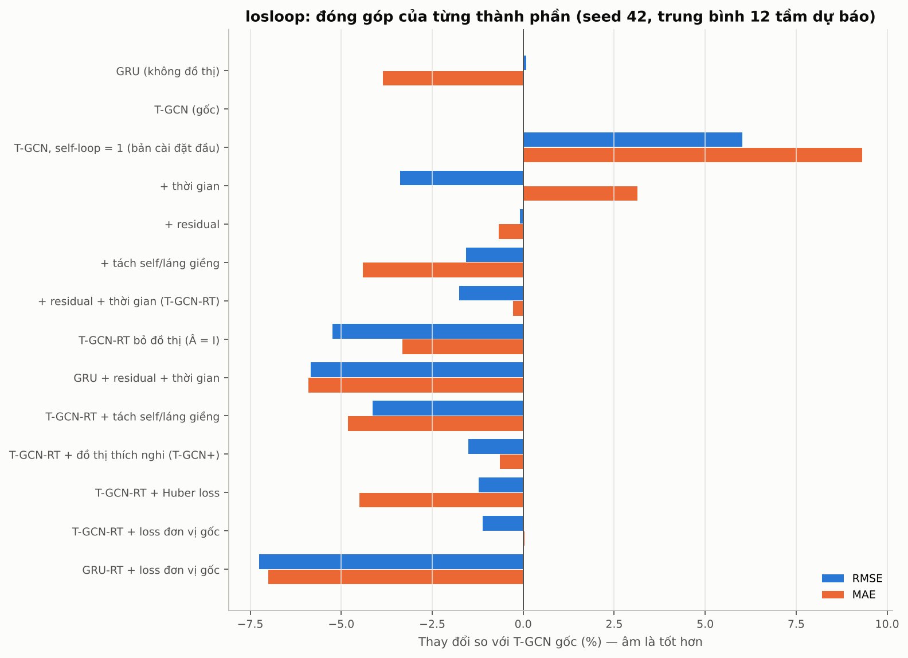

Đọc bảng ablation theo cặp có kiểm soát:

- **Residual sửa tầm ngắn, đặc trưng thời gian sửa tầm dài.** T-GCN + residual: 5 phút 4.84 → 4.33 nhưng 60 phút gần như không đổi; T-GCN + thời gian: 60 phút 9.07 → 8.53 nhưng 5 phút xấu đi. Kết hợp (T-GCN-RT) lấy được cả hai.
- **Cùng ô T-GCN-RT nhưng bỏ đồ thị (Â = I) lại tốt hơn có đồ thị** (7.09 so với 7.35). Với cách chuẩn hóa của tác giả, đồ thị vật lý gây hại khi mô hình đã có residual + thời gian.
- **Tách self/láng giềng ([x, Âx]W) là cách duy nhất làm đồ thị có lợi:** T-GCN tách self (không RT) đạt SELFSEP_PLAIN — tốt hơn cả GRU và T-GCN gốc; T-GCN-RT tách self đạt 7.17 / 4.13 so với 7.35 / 4.32 của T-GCN-RT.
- **Loss theo đơn vị gốc** (nhân trọng số std² cho mỗi cảm biến) cải thiện GRU-RT ở mọi tầm (6.94 / 4.03 so với 7.05 / 4.08, cùng seed) vì cảm biến hay kẹt (phương sai lớn) được coi trọng đúng mức; không giúp T-GCN-RT.
- **Huber** đổi RMSE lấy MAE (MAE 4.32 → 4.14, RMSE 7.35 → 7.39) — đúng như lý thuyết (Huber nhắm trung vị nhiều hơn kỳ vọng).
- **Đồ thị thích nghi (T-GCN+)** không mang lại gì (7.37 so với 7.35): 207 × 8 tham số embedding không học được quan hệ mới từ 5 ngày dữ liệu.

### 5.5 Mô hình cuối cùng — chọn bằng validation, không bằng test

Để không lặp lại lỗi chọn-theo-test của bài báo, cấu hình cuối được chọn theo **RMSE validation** (đơn vị gốc, so sánh được giữa các hàm mất mát), sau đó mới xem test:

FINAL_TABLE

FINAL_TEXT


## 6. Mô hình huấn luyện được là gì và cách đọc lên để dự báo

### 6.1 "Mô hình" thực chất là gì

Sau huấn luyện, mô hình là **một tệp checkpoint** (`best.pt`, ≈ 60–70 KB) — chính là trạng thái ở epoch có MSE validation nhỏ nhất. Tệp này là một `dict` PyTorch gồm:

| Khóa | Nội dung |
|---|---|
| `state_dict` | các tensor trọng số đã học (bảng dưới) |
| `config` | toàn bộ siêu tham số của lần chạy: `model`, `seq_len`, `horizon`, `hidden_dim`, `residual`, `time_features`, `self_sep`, lr, seed... |
| `data_stats` | trung bình/độ lệch chuẩn của **train** cho từng cảm biến, ma trận  đã chuẩn hóa, danh sách mã cảm biến, bước thời gian ⇒ checkpoint **tự đủ**, không cần đọc lại dữ liệu train |
| `best_epoch`, `best_val_mse_scaled` | epoch được chọn và sai số validation tương ứng |

Thẻ mô hình của T-GCN-RT (Los-loop, hidden = 64, L = 12, H = 12):

| Tensor | Kích thước | Số phần tử | Học? | Vai trò |
|---|---|---|---|---|
| `adj` | 207x207 | 42,849 | không | Â = D^-1/2 (A+I) D^-1/2 (cố định, không học) |
| `cell.gates.linear.weight` | 128x69 | 8,832 | có | W_g: GCN trong cổng reset r và update u, [2H, 1(+4)+H] |
| `cell.gates.linear.bias` | 128 | 128 | có | b_g: bias cổng (khởi tạo 1.0 như mã tác giả) |
| `cell.candidate.linear.weight` | 64x69 | 4,416 | có | W_c: GCN tạo trạng thái ứng viên c, [H, 1(+4)+H] |
| `cell.candidate.linear.bias` | 64 | 64 | có | b_c |
| `head.weight` | 12x64 | 768 | có | W_out: ánh xạ trạng thái ẩn → H bước dự báo |
| `head.bias` | 12 | 12 | có | b_out |

Tổng số tham số học được: **14,220**.

Điểm đáng chú ý: **mọi nút dùng chung một bộ trọng số** (W_g, W_c, W_out không phụ thuộc N). Vì vậy mô hình rất nhỏ (≈ 14 nghìn tham số cho 207 cảm biến); điều làm các nút khác nhau là (i) chuỗi đầu vào của chính nút và (ii) láng giềng của nó qua Â. Hệ quả thực tế: không thể dùng checkpoint Los-loop cho SZ-taxi (khác Â, khác thống kê chuẩn hóa), nhưng có thể thêm cảm biến mới nếu biết vị trí của nó trên đồ thị.

### 6.2 Quy trình dự báo khi "đọc" mô hình lên

```
1. Đọc checkpoint         ck = torch.load('models/losloop_tgcn_res_time.pt')
2. Dựng lại kiến trúc     model = build_model(Namespace(**ck['config']), Â)   # từ data_stats
3. Nạp trọng số           model.load_state_dict(ck['state_dict']); model.eval()
4. Lấy 12 mốc gần nhất    X_raw: [12, 207]  (tốc độ thô, mph)
5. Chuẩn hóa              X = (X_raw − mean_train) / std_train
6. Đặc trưng thời gian    sin/cos(giờ), sin/cos(thứ) của 12 mốc đó
7. Chạy mô hình           ŷ = model(X, time) → [12, 207]   (12 bước × 207 cảm biến)
8. Đổi về đơn vị gốc      Ŷ = ŷ · std_train + mean_train
```

Toàn bộ quy trình được đóng gói trong `predict.py` (lớp `Forecaster`). Ví dụ dự báo lúc 07:30 sáng thứ Tư 07/03/2012 (giờ cao điểm, nằm trong tập test) và đối chiếu với thực tế:

```bash
python predict.py --checkpoint models/losloop_tgcn_res_time.pt --input data/losloop/speed.csv --end-time "2012-03-07 07:30" --compare --sensors 4
```

*(chạy `python tools/export_models.py` trước)*

Đầu ra có thể ghi ra CSV (`--output forecast.csv`, H dòng × N cột). Muốn dùng dữ liệu mới: chỉ cần CSV cùng thứ tự cột cảm biến và thời điểm bắt đầu (`--start-time`).


## 7. Minh chứng — giải thích kết quả từ cách mô hình hoạt động

### 7.1 Ảnh hưởng của thuộc tính lên mô hình dự báo

Chúng tôi đo **permutation importance trên tập test**: xáo trộn một nhóm đầu vào giữa các mẫu (giữ nguyên phân phối, cắt đứt liên hệ với mục tiêu) rồi xem RMSE tăng bao nhiêu. Với đầu vào không gian, phép đo làm riêng cho từng nút đích (40 nút ngẫu nhiên): xáo trộn chuỗi của chính nút / của các láng giềng 1-hop / của cùng số nút ở xa (≥ 4 hop, đối chứng).

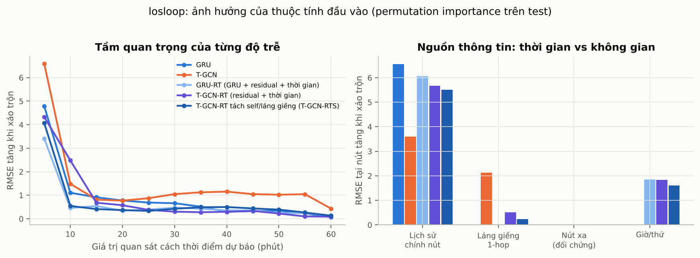

*ΔRMSE = RMSE tăng thêm khi xáo trộn nhóm đầu vào (cột không gian: RMSE tại nút đích, TB 40 nút).*

| Mô hình | RMSE gốc | lag 5 phút | lag 15 phút | lag 60 phút | lịch sử của chính nút | láng giềng 1-hop | nút ngẫu nhiên xa (≥4 hop) | đặc trưng thời gian (giờ, thứ) |
|---|---|---|---|---|---|---|---|---|
| GRU | 7.488 | 4.786 | 0.913 | 0.066 | 6.555 | 0.000 | 0.000 | — |
| T-GCN | 7.482 | 6.593 | 0.812 | 0.433 | 3.593 | 2.122 | -0.000 | — |
| GRU-RT (GRU + residual + thời gian) | 7.045 | 3.410 | 0.542 | 0.139 | 6.061 | 0.000 | 0.000 | 1.850 |
| T-GCN-RT (residual + thời gian) | 7.350 | 4.331 | 0.683 | 0.089 | 5.673 | 0.507 | -0.000 | 1.833 |
| T-GCN-RT tách self/láng giềng (T-GCN-RTS) | 7.172 | 4.070 | 0.412 | 0.130 | 5.502 | 0.237 | -0.000 | 1.606 |

Đọc kết quả:

- **Độ trễ gần nhất áp đảo.** Với mọi mô hình, xáo trộn giá trị 5 phút trước làm RMSE tăng mạnh nhất; từ 15 phút trở về trước ảnh hưởng nhỏ dần. Điều này khớp với tự tương quan (0.82 ở 5 phút) và giải thích vì sao persistence mạnh. Riêng T-GCN gốc dựa nhiều hơn vào các độ trễ xa (30–55 phút) — dấu hiệu trạng thái ẩn bị "làm trơn" theo cả không gian lẫn thời gian.
- **Lịch sử của chính nút là nguồn thông tin chính (ΔRMSE ≈ 5.5–6.6).** T-GCN gốc là ngoại lệ: chỉ 3.6 cho chính nút nhưng 2.1 cho láng giềng — mô hình bị buộc "nhìn" láng giềng nhiều hơn chính mình.
- **Láng giềng xa có ảnh hưởng đúng bằng 0** với mọi mô hình (kiểm tra hợp lệ của phương pháp); với GRU, láng giềng 1-hop cũng bằng 0 — đúng thiết kế.
- **Đặc trưng thời gian (giờ, thứ) có ích rõ** cho các mô hình RT (ΔRMSE ≈ 1.6–1.8), chủ yếu ở tầm xa (mục 5.4).

### 7.2 Trường tiếp nhận không gian–thời gian

Gradient saliency |∂ŷ_i/∂x_j(t−ℓ)| (dự báo 15 phút) gộp theo khoảng cách đồ thị giữa i và j và theo độ trễ ℓ cho thấy mô hình *thực sự* nhìn vào đâu:

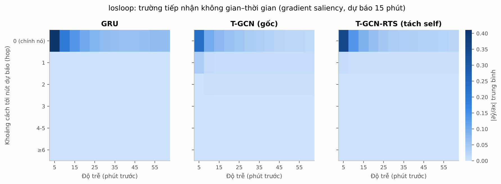

- **GRU** chỉ nhạy với chính nút (hàng 0 hop), giảm dần theo độ trễ.
- **T-GCN gốc**: độ nhạy với chính nút ở độ trễ 5 phút giảm từ ≈ 0.41 (GRU) xuống ≈ 0.27, phần còn lại chuyển sang láng giềng 1–2 hop. Vì mỗi bước GRU áp  lên cả đầu vào lẫn trạng thái ẩn, trường tiếp nhận về lý thuyết mở rộng thêm ít nhất 1 hop mỗi bước; thực tế mô hình chỉ dùng tới ~2 hop.
- **T-GCN tách self/láng giềng** khôi phục độ nhạy với chính nút (≈ 0.40) mà vẫn giữ một phần thông tin 1-hop — đúng như thiết kế.

### 7.3 Vì sao T-GCN không thắng GRU: tín hiệu của chính nút bị "loãng"

Với  = D^(-1/2)(A + I)D^(-1/2), giá trị mà nút i "thấy" ở mỗi bước là Σ_j Â_ij x_j. Trên Los-loop (bậc trung bình 12.7, cạnh có trọng số), **phần trọng số dành cho chính nút chỉ là 32% (trung vị 26%)** với chuẩn hóa của tác giả, và 20.5% nếu self-loop = 1. Nghĩa là ~70% "đầu vào" của mỗi nút là tốc độ của láng giềng. Muốn dự báo y_{t+5'} ≈ x_t (điều persistence làm được), mạng phải tự "gỡ trộn" — điều một phép biến đổi tuyến tính dùng chung cho mọi nút không làm được chính xác. Ba bằng chứng độc lập:

1. **Liều–đáp ứng:** self-loop 1 → 2 (tỉ trọng tự thân 20% → 32%) đưa RMSE 5 phút của T-GCN từ 5.96 về 4.84; tách hẳn self ([x, Âx]W, tỉ trọng 100%) đưa về 4.23 = GRU.
2. **Permutation importance** (7.1): T-GCN gốc dùng lịch sử chính nút ít hơn hẳn các mô hình khác.
3. **Bảng lỗi theo tầm:** T-GCN kém ở tầm ngắn (cần chính xác giá trị hiện tại), tốt hơn ở tầm xa (cần xu hướng khu vực, nơi trung bình láng giềng là thông tin tốt) — đúng chữ ký của một bộ lọc thông thấp không gian.

Điều này cũng giải thích **P5** (MAE của GRU luôn thấp hơn T-GCN trong Bảng 1 bài báo): trung bình hóa theo láng giềng làm dự báo trơn hơn, giảm sai số lớn (RMSE) nhưng tăng sai số điển hình (MAE).

### 7.4 Vì sao residual và đặc trưng thời gian có ích

- **Skill so với persistence** (Hình 14): GRU-RT +9% ở 5 phút → +40% ở 60 phút; T-GCN gốc −19% ở 5 phút. Residual biến bài toán thành "dự báo phần thay đổi", nên mô hình mặc định đã ≥ persistence; thời gian cho biết xu hướng sắp tới (sắp vào/ra giờ cao điểm), thứ mà 60 phút lịch sử không chứa.
- **Mô hình dự báo được bao nhiêu phần thay đổi?** Hồi quy thay đổi dự báo theo thay đổi thực (Hình 15): hệ số góc chỉ 0.22 (15 phút) và 0.41 (60 phút) với T-GCN-RT; tương quan 0.38 và 0.59. Mô hình chỉ dám dự báo 20–40% biên độ thay đổi thật — đặc trưng của dự báo kỳ vọng có điều kiện dưới loss MSE khi tương lai bất định (sắp kẹt hay không).
- **Cổng cập nhật u của GRU bên trong T-GCN** (Hình 16) phản ứng đúng với trạng thái giao thông: u (giữ bộ nhớ) cao khi thông thoáng (tương quan Spearman +0.47 với tốc độ hiện tại) và giảm khi vừa có biến động lớn (−0.13 với |Δ| gần nhất) — mô hình "ghi đè" bộ nhớ bằng quan sát mới khi tình huống thay đổi. Ở T-GCN-RT, u thấp hơn hẳn (≈ 0.45 so với 0.78): vì phần "giữ giá trị cũ" đã có residual lo, trạng thái ẩn chỉ còn mã hóa thay đổi.

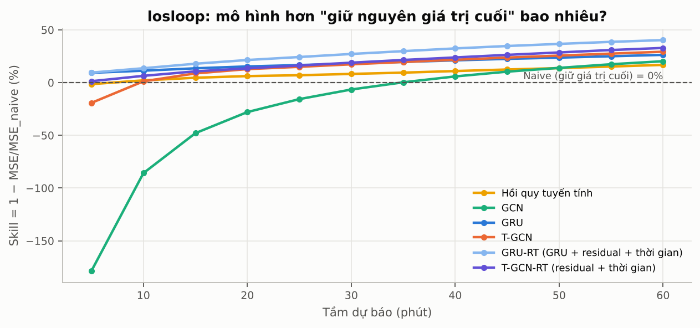

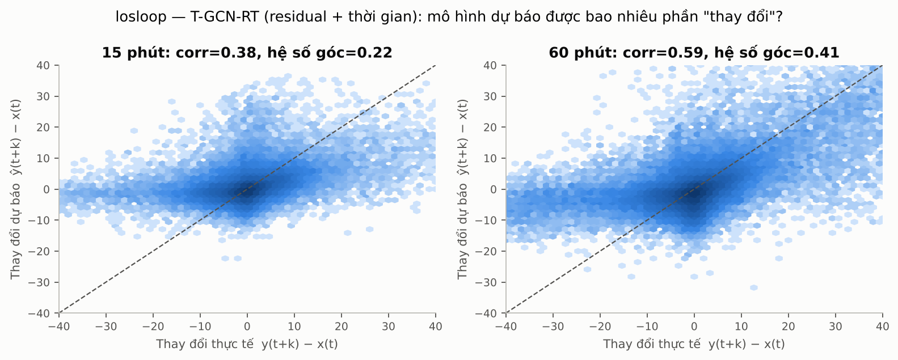

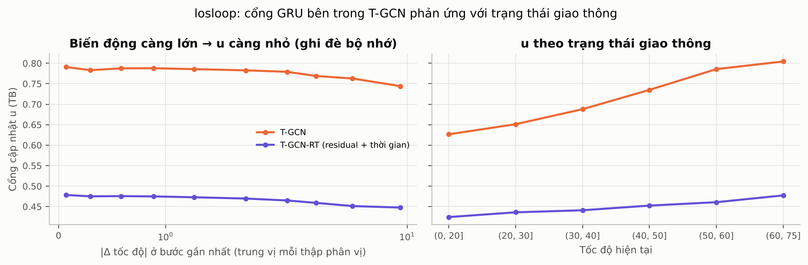

### 7.5 Vì sao dữ liệu này hạn chế lợi ích của đồ thị

Ngay ở bước EDA (mục 2.2), tương quan của *biến động* 5 phút giữa hai nút kề chỉ 0.066: láng giềng cho biết mức tốc độ chung của khu vực nhưng gần như không báo trước dao động kế tiếp. Cộng với chỉ 5 ngày train, mô hình có thêm thông tin không gian dễ học các mẫu trùng hợp hơn là quy luật (T-GCN-RT tách self dừng sớm ở epoch 18; T-GCN+ không học được gì từ đồ thị thích nghi). Đồ thị chỉ có lợi rõ ràng ở các sự kiện biến động mạnh (mục 5.3) và ở tầm xa.


## 8. Đánh giá độ tin cậy của mô hình

### 8.1 Độ ổn định theo seed

| Mô hình | seed | RMSE | CV RMSE | MAE | epoch chọn |
|---|---|---|---|---|---|
| GRU-RT (GRU + residual + thời gian) | 3 | 6.981 ± 0.063 | 0.91% | 4.065 ± 0.063 | [37, 19, 33] |
| T-GCN-RT (residual + thời gian) | 3 | 7.375 ± 0.043 | 0.58% | 4.325 ± 0.029 | [29, 31, 33] |
| GRU | 3 | 7.495 ± 0.006 | 0.08% | 4.175 ± 0.023 | [87, 93, 101] |
| T-GCN | 3 | 7.516 ± 0.031 | 0.41% | 4.371 ± 0.037 | [78, 96, 65] |
| GCN | 3 | 8.606 ± 0.009 | 0.10% | 5.345 ± 0.009 | [108, 103, 105] |

Độ lệch chuẩn giữa các seed nhỏ (CV ≤ 1%) đối với mọi mô hình, nhưng **cùng cỡ với nhiều khác biệt mà bài báo dùng để kết luận** (ví dụ T-GCN hơn GRU 1.8% RMSE ở "15 phút"). Ensemble 3 seed luôn cải thiện nhẹ và có ý nghĩa (GRU-RT: 6.98 → 6.91, DM p < 10⁻⁴).

### 8.2 Khác biệt nào có ý nghĩa thống kê?

Kiểm định cặp trên cùng các mẫu test: bootstrap khối dịch chuyển (khối 12 mẫu = 1 giờ, giữ tự tương quan) cho KTC 95% của ΔRMSE, và kiểm định Diebold–Mariano (phương sai Newey–West). Sai số mỗi mẫu được lấy trung bình qua 3 seed.

| A | B | RMSE A | RMSE B | ΔRMSE (A−B) | KTC 95% | DM p | Kết luận |
|---|---|---|---|---|---|---|---|
| T-GCN | GRU | 7.516 | 7.495 | +0.022 | [-0.115; +0.153] | 0.7626 | không khác biệt |
| T-GCN | Naive (giữ giá trị cuối) | 7.516 | 8.418 | -0.902 | [-1.542; -0.389] | 0.0040 | A tốt hơn |
| GRU | Naive (giữ giá trị cuối) | 7.495 | 8.418 | -0.923 | [-1.542; -0.399] | 0.0037 | A tốt hơn |
| T-GCN | Hồi quy tuyến tính | 7.516 | 7.944 | -0.427 | [-0.690; -0.185] | 0.0025 | A tốt hơn |
| T-GCN-RT (residual + thời gian) | T-GCN | 7.375 | 7.516 | -0.141 | [-0.387; +0.109] | 0.2794 | không khác biệt |
| T-GCN-RT (residual + thời gian) | Naive (giữ giá trị cuối) | 7.375 | 8.418 | -1.043 | [-1.705; -0.528] | 0.0009 | A tốt hơn |
| T-GCN-RT (residual + thời gian) | GRU-RT (GRU + residual + thời gian) | 7.375 | 6.981 | +0.394 | [+0.211; +0.667] | 0.0026 | B tốt hơn |
| T-GCN-RT (residual + thời gian) | Hồi quy tuyến tính | 7.375 | 7.944 | -0.569 | [-1.000; -0.163] | 0.0126 | A tốt hơn |
| GRU-RT (GRU + residual + thời gian) | GRU | 6.981 | 7.495 | -0.513 | [-0.785; -0.253] | 0.0007 | A tốt hơn |
| GRU-RT (GRU + residual + thời gian) | Naive (giữ giá trị cuối) | 6.981 | 8.418 | -1.437 | [-2.180; -0.872] | < 0.0001 | A tốt hơn |
| Ensemble T-GCN-RT (3 seed) | T-GCN-RT (residual + thời gian) | 7.266 | 7.375 | -0.109 | [-0.159; -0.070] | < 0.0001 | A tốt hơn |
| Ensemble GRU-RT (3 seed) | GRU-RT (GRU + residual + thời gian) | 6.911 | 6.981 | -0.071 | [-0.092; -0.053] | < 0.0001 | A tốt hơn |

Kết luận: (i) mọi mô hình học sâu vượt persistence có ý nghĩa; (ii) **T-GCN và GRU không khác nhau có ý nghĩa** (p = 0.76); (iii) residual + thời gian cải thiện GRU có ý nghĩa (p < 0.001); (iv) trong cấu hình RT, GRU-RT tốt hơn T-GCN-RT có ý nghĩa (p = 0.003).

Lưu ý: tập test của Los-loop chỉ là ~1.4 ngày (2 đợt cao điểm chiều, 1 đợt sáng). Các KTC trên phản ánh bất định *trong* giai đoạn đó, không bảo đảm cho tuần khác, mùa khác hay ngày lễ.

### 8.3 Độ bền khi dữ liệu đầu vào xấu

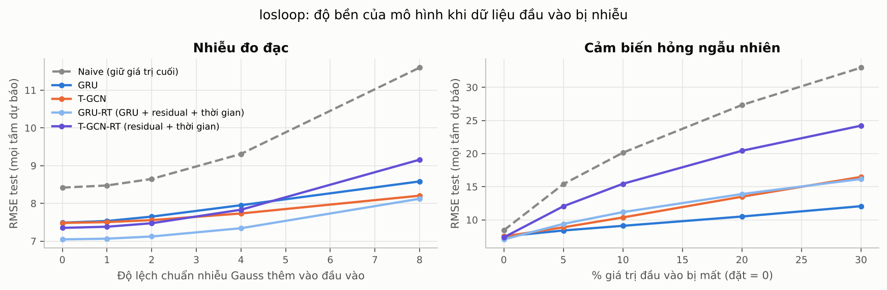

- **Nhiễu đo đạc:** mọi mô hình suy giảm chậm hơn persistence. Trong nhóm không residual, **T-GCN bền nhất** (σ = 8 mph: RMSE 8.20 so với 8.58 của GRU): tích chập đồ thị trung bình hóa nhiễu độc lập giữa các cảm biến — đây là một lợi ích thật của đồ thị mà sai số trên dữ liệu sạch không cho thấy.
- **Cảm biến hỏng (đầu vào = 0):** các mô hình residual **rất mong manh** (5% đầu vào hỏng: T-GCN-RT 7.35 → 12.0; GRU-RT 7.05 → 9.4) vì chúng cộng thẳng giá trị cuối (= 0). GRU thường bền nhất (8.4). ⇒ Khi triển khai mô hình residual **bắt buộc** phải kiểm tra/điền giá trị thiếu trước khi dự báo.

### 8.4 Khoảng dự báo có đáng tin không? (conformal)

Dùng phần dư trên validation để dựng khoảng dự báo 90% (split conformal, theo từng tầm; biến thể theo từng tầm × từng nút):

| Mô hình | tầm | độ phủ tổng (%) | cao điểm (%) | ngoài cao điểm (%) | độ rộng TB (mph) |
|---|---|---|---|---|---|
| GRU | 15 phút | 87.0 | 78.9 | 89.6 | 13.0 |
| GRU | 30 phút | 85.6 | 73.7 | 89.4 | 14.7 |
| GRU | 60 phút | 84.5 | 68.5 | 89.7 | 18.1 |
| T-GCN | 15 phút | 86.6 | 75.4 | 90.2 | 14.3 |
| T-GCN | 30 phút | 85.6 | 72.8 | 89.7 | 15.8 |
| T-GCN | 60 phút | 85.0 | 70.0 | 89.9 | 19.0 |
| T-GCN-RT (residual + thời gian) | 15 phút | 86.6 | 78.5 | 89.2 | 13.7 |
| T-GCN-RT (residual + thời gian) | 30 phút | 86.0 | 75.7 | 89.3 | 15.5 |
| T-GCN-RT (residual + thời gian) | 60 phút | 86.2 | 73.3 | 90.3 | 19.2 |

Độ phủ thực tế 85–87% (thấp hơn mục tiêu 90%) và chỉ **69–79% trong giờ cao điểm** — vì phân phối sai số thay đổi giữa validation (sáng thứ Ba) và test (chiều thứ Ba–thứ Tư). Khoảng dự báo dùng được ngoài cao điểm (≈ 89–90%), nhưng cần hiệu chỉnh theo giờ (conformal có điều kiện) nếu dùng cho cảnh báo kẹt xe.

### 8.5 Các kiểm tra khác

- **Điểm nội suy:** loại 4.6% mục tiêu test nằm trên đoạn nội suy thẳng làm RMSE của mọi mô hình tăng ~0.06–0.10 (các điểm nội suy "dễ" hơn), thứ hạng không đổi.
- **Độ lệch theo mức tốc độ** (Hình 13): khi thực tế ≤ 20 mph, GRU/T-GCN dự báo cao hơn trung bình ~9 mph; khi thông thoáng (> 60 mph) thấp hơn ~1.4 mph. Mô hình "co về trung bình"; độ tin cậy thấp nhất đúng lúc cần nhất (kẹt xe).
- **Độ lạc quan của việc chọn epoch theo test:** trung bình 0.53%, tối đa 1.7% RMSE (mục 4.1).

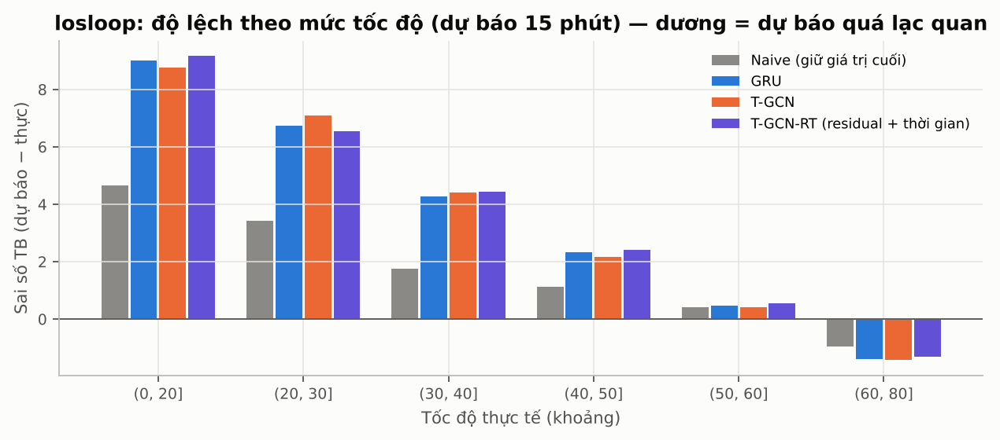


## 9. So sánh với bài báo

### 9.1 Cùng cách tính của bài báo ("15 phút" = trung bình các bước 1…k)

Los-loop, giao thức nghiêm ngặt của chúng tôi (chọn epoch bằng validation), so với Bảng 1 của Zhao et al. (chọn epoch bằng test). Mỗi ô: RMSE / MAE / Accuracy / R².

| Mô hình | nguồn | 15 phút | 30 phút | 45 phút | 60 phút |
|---|---|---|---|---|---|
| HA (TB cửa sổ) | bài báo | 7.44 / 4.01 / 0.873 / 0.712 | 7.44 / 4.01 / 0.873 / 0.712 | 7.44 / 4.01 / 0.873 / 0.712 | 7.44 / 4.01 / 0.873 / 0.712 |
| HA (TB cửa sổ) | chúng tôi | 7.49 / 3.97 / 0.872 / 0.708 | 8.31 / 4.37 / 0.858 / 0.641 | 9.04 / 4.74 / 0.846 / 0.574 | 9.71 / 5.10 / 0.835 / 0.508 |
| Hồi quy tuyến tính (SVR) | bài báo | 6.01 / 3.73 / 0.898 / 0.812 | 6.96 / 3.72 / 0.881 / 0.749 | 7.75 / 4.13 / 0.868 / 0.690 | 8.44 / 4.50 / 0.856 / 0.634 |
| Hồi quy tuyến tính | chúng tôi | 5.49 / 3.18 / 0.906 / 0.843 | 6.52 / 3.70 / 0.889 / 0.779 | 7.30 / 4.14 / 0.876 / 0.722 | 7.94 / 4.51 / 0.865 / 0.671 |
| GCN | bài báo | 7.79 / 5.35 / 0.867 / 0.684 | 8.34 / 5.61 / 0.858 / 0.640 | 8.80 / 5.95 / 0.850 / 0.600 | 9.27 / 6.29 / 0.842 / 0.558 |
| GCN | chúng tôi | 7.63 / 4.74 / 0.870 / 0.697 | 7.96 / 4.95 / 0.864 / 0.670 | 8.29 / 5.15 / 0.859 / 0.642 | 8.61 / 5.34 / 0.853 / 0.614 |
| GRU | bài báo | 5.22 / 3.06 / 0.911 / 0.858 | 6.28 / 3.65 / 0.893 / 0.796 | 7.03 / 4.09 / 0.880 / 0.745 | 7.66 / 4.52 / 0.869 / 0.698 |
| GRU | chúng tôi | 5.22 / 2.96 / 0.911 / 0.858 | 6.18 / 3.44 / 0.895 / 0.801 | 6.90 / 3.83 / 0.883 / 0.752 | 7.49 / 4.17 / 0.872 / 0.707 |
| T-GCN | bài báo | 5.13 / 3.18 / 0.913 / 0.863 | 6.06 / 3.75 / 0.897 / 0.810 | 6.71 / 4.12 / 0.886 / 0.768 | 7.27 / 4.60 / 0.876 / 0.728 |
| T-GCN | chúng tôi | 5.55 / 3.36 / 0.905 / 0.840 | 6.36 / 3.75 / 0.892 / 0.789 | 7.00 / 4.08 / 0.881 / 0.745 | 7.52 / 4.37 / 0.872 / 0.706 |
| Naive (giữ giá trị cuối) | chúng tôi | 5.56 / 3.15 / 0.905 / 0.839 | 6.71 / 3.63 / 0.886 / 0.766 | 7.62 / 4.03 / 0.870 / 0.698 | 8.42 / 4.41 / 0.857 / 0.631 |
| GRU-RT (GRU + residual + thời gian) | chúng tôi | 5.13 / 3.05 / 0.913 / 0.863 | 5.96 / 3.47 / 0.899 / 0.815 | 6.53 / 3.79 / 0.889 / 0.778 | 6.98 / 4.07 / 0.881 / 0.746 |
| Ensemble GRU-RT (3 seed) | chúng tôi | 5.09 / 3.01 / 0.913 / 0.865 | 5.90 / 3.43 / 0.899 / 0.819 | 6.47 / 3.74 / 0.890 / 0.782 | 6.91 / 4.01 / 0.882 / 0.751 |

- **HA, GCN, GRU tái lập sát bài báo**; HA trung bình cửa sổ của chúng tôi gần như trùng HA của tác giả ở "15 phút" (7.49 / 3.97 so với 7.44 / 4.01), xác nhận cách hiểu "HA = trung bình 12 bước đầu vào".
- **Hồi quy tuyến tính của chúng tôi tốt hơn SVR của bài báo** (5.49 so với 6.01 ở 15 phút) — baseline của bài báo yếu hơn mức có thể đạt.
- **T-GCN của chúng tôi kém con số bài báo** (5.55 so với 5.13 ở 15 phút; 7.52 so với 7.27 ở 60 phút). Mục 9.2 kiểm tra xem bao nhiêu phần đến từ giao thức.
- **Mô hình cải tiến (ensemble GRU-RT) vượt mọi con số của bài báo**: "15 phút" 5.09 / 3.01 (bài báo T-GCN 5.13 / 3.18), "60 phút" 6.91 / 4.01 (7.27 / 4.60) — dưới giao thức chặt hơn và ít dữ liệu train hơn.

### 9.2 Tái lập đúng giao thức của tác giả

Chúng tôi chạy lại GRU và T-GCN theo **đúng giao thức trong mã của tác giả** (`--protocol paper`): chia 80/20 không có validation, chuẩn hóa chia cho max của toàn chuỗi, cửa sổ test nằm trọn trong 20% cuối, lr 10⁻³ cố định, batch 32, hidden 64 (Los-loop) / 100 (SZ-taxi), dự báo pre_len = 3 bước (Los-loop, "15 phút") và 1 bước (SZ-taxi), **giữ epoch có RMSE test nhỏ nhất**. Do giới hạn CPU, chúng tôi train 300 epoch (Los-loop) và 150 epoch (SZ-taxi) — 5–10% so với 3000 epoch của tác giả.

| Bộ dữ liệu | Mô hình | epoch train | Chúng tôi (RMSE / MAE) | Bài báo (RMSE / MAE) | Accuracy / R² (chúng tôi | bài báo) |
|---|---|---|---|---|---|
| losloop | Naive (giữ giá trị cuối) | — | 5.543 / 3.156 | — (không báo cáo) | — |
| losloop | T-GCN | 300 (tốt nhất: 297) | 5.356 / 3.247 | 5.126 / 3.180 | 0.909 / 0.851 | 0.913 / 0.863 |
| sztaxi | Naive (giữ giá trị cuối) | — | 5.260 / 3.317 | — (không báo cáo) | — |
| sztaxi | T-GCN | 150 (tốt nhất: 150) | 4.404 / 3.074 | 3.916 / 2.706 | 0.693 / 0.822 | 0.731 / 0.854 |

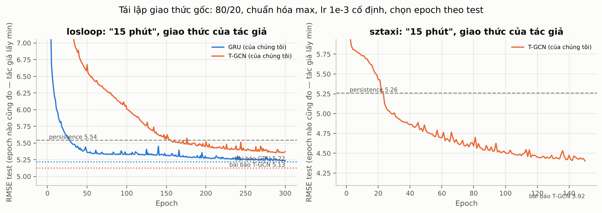

Nhận xét:

- **GRU tái lập được bài báo ngay cả với ít epoch** (bão hòa sớm). **T-GCN hội tụ rất chậm** dưới chuẩn hóa max và lr cố định: Los-loop 6.01 (epoch 100) → 5.52 (200) → 5.36 (300), vẫn đang giảm; với 3000 epoch có thể tiến tới con số 5.13 của bài báo. Chúng tôi không ngoại suy; điều chắc chắn là ở cùng ngân sách huấn luyện, T-GCN chưa vượt GRU.
- **Ngay cả dưới giao thức của tác giả, MAE của T-GCN (3.25) vẫn kém persistence (3.16)** trên đúng các cửa sổ test đó — điểm P4 không phụ thuộc vào cách chúng tôi huấn luyện.
- Trên SZ-taxi, T-GCN sau 150 epoch (RMSE 4.40) còn kém trung bình trượt 3 giờ (4.16) — với chuỗi nhiễu như SZ-taxi, phần lớn "kỹ năng" mà bài báo báo cáo có thể đạt bằng một trung bình trượt.
- Giao thức nghiêm ngặt của chúng tôi (z-score theo train, lr cosine, dừng sớm bằng validation) cho T-GCN hội tụ trong ~100 epoch; đây là lý do chúng tôi dùng nó cho mọi so sánh chính.

### 9.3 Tóm tắt các giả thuyết

| Giả thuyết | Kết luận | Bằng chứng chính |
|---|---|---|
| H1 – Đồ thị có ích (T-GCN > GRU) | **Bác bỏ ở dạng gốc; đúng một phần sau khi sửa** | T-GCN ≈ GRU (p = 0.76), MAE kém hơn; đồ thị chỉ giúp ở tầm xa, biến động mạnh, dữ liệu nhiễu; dạng tách self/láng giềng thì tốt hơn GRU |
| H2 – Học sâu > baseline đơn giản | **Đúng tổng thể, sai ở giờ cao điểm** | Mọi mô hình vượt persistence (p < 0.005), nhưng trong cao điểm/kẹt xe persistence có MAE thấp nhất |
| H3 – Con số bài báo đáng tin | **Lạc quan** | Chọn epoch theo test, gộp tầm dự báo, không baseline persistence, không độ biến thiên |
| H4 – Có thể cải tiến | **Đúng** | Residual + thời gian (+ loss đơn vị gốc, ensemble): −8% RMSE so với GRU/T-GCN, có ý nghĩa thống kê |

## 10. Kiểm chứng trên SZ-taxi

SZ_SECTION

## 11. Hạn chế và hướng phát triển

**Hạn chế của nghiên cứu này**

- Los-loop chỉ 7 ngày: tập test ~1.4 ngày; kết luận về giờ cao điểm dựa trên 3 đợt cao điểm. Cần lặp lại trên METR-LA đầy đủ (4 tháng, cùng 207 cảm biến) hoặc PEMS-BAY (bộ dữ liệu trong danh sách bài báo tham khảo).
- Huấn luyện trên CPU: ≤ 120 epoch với lịch học cosine thay vì 3000 epoch như tác giả; tinh chỉnh và một số biến thể chỉ có 1 seed.
- Không có dữ liệu sự kiện (tai nạn, thời tiết) — nguyên nhân của phần lớn sai số lớn trong giờ cao điểm.

**Hướng phát triển (theo thứ tự lợi ích kỳ vọng / chi phí)**

1. **Đưa vào sản phẩm ngay:** ensemble GRU-RT (hoặc GRU-RT loss đơn vị gốc) + bước kiểm tra dữ liệu thiếu (mô hình residual rất nhạy với đầu vào = 0) + cắt dự báo về [0, v_max].
2. **Tích chập đồ thị không làm loãng tín hiệu:** dạng [x, Âx]W đã cho kết quả tốt; bước tiếp theo là diffusion convolution hai chiều của DCRNN (Li et al., 2018 — bài báo thứ 2 trong danh sách tham khảo), phù hợp đồ thị có hướng như SZ-taxi.
3. **Hàm mất mát cho giờ cao điểm:** loss đơn vị gốc đã giúp; có thể thêm trọng số cho mẫu kẹt xe hoặc dự báo phân vị (quantile loss) để có khoảng dự báo đáng tin hơn trong cao điểm.
4. **Conformal theo giờ** để khoảng dự báo đạt độ phủ đúng cả trong giờ cao điểm.
5. **Dữ liệu dài hơn:** với ≥ 1 tháng dữ liệu, đặc trưng thời gian và đồ thị thích nghi có cơ hội phát huy (hiện bị quá khớp).

## 12. Kết luận

Chúng tôi đã cài đặt lại và chạy GRU, GCN, T-GCN cùng 4 baseline cổ điển trên Los-loop và SZ-taxi với cùng dữ liệu, cùng cách chia và 3 seed. **GRU tái lập đúng bài báo; T-GCN thì không vượt được GRU** một cách có ý nghĩa — chính Bảng 1 của bài báo cũng cho thấy MAE của GRU tốt hơn. Nguyên nhân cơ chế là phép chuẩn hóa D^(-1/2)(A+I)D^(-1/2) chỉ để lại ~30% trọng số cho tín hiệu của chính nút, làm hỏng dự báo tầm ngắn; bằng chứng đến từ ba hướng độc lập (thí nghiệm liều–đáp ứng với self-loop, permutation importance và gradient saliency). Con số của bài báo còn được "làm đẹp" bởi việc chọn epoch theo test và cách gộp tầm dự báo, và bài báo bỏ qua baseline persistence — baseline vốn tốt nhất trong giờ cao điểm. Cải tiến hiệu quả nhất không nằm ở đồ thị mà ở **cách đặt bài toán**: học phần thay đổi so với giá trị cuối (residual), cho mô hình biết giờ trong ngày, và cân loss theo đơn vị gốc; ensemble 3 seed của GRU-RT giảm RMSE ~8% so với GRU/T-GCN (có ý nghĩa thống kê) và vượt mọi con số trong bài báo dù dùng giao thức chặt hơn. Đồ thị vẫn có giá trị — ở tầm xa, khi tốc độ biến động mạnh, khi dữ liệu nhiễu — nhưng chỉ khi được thiết kế để không xóa mờ thông tin riêng của từng nút.

## Phụ lục A. Cách chạy lại toàn bộ

```bash
pip install -r requirements.txt
python download_data.py --dataset losloop
python download_data.py --dataset sztaxi
python -m unittest discover -s tests -v                   # 8 test
python baselines.py --dataset losloop                     # naive, HA, linear
python baselines.py --dataset sztaxi
python run_suite.py --spec losloop:main losloop:improve losloop:variants losloop:tuning --jobs 4
python run_suite.py --spec losloop:paper sztaxi:paper sztaxi:main sztaxi:improve --jobs 4
python analysis/eda.py
python analysis/compare_models.py --dataset losloop      # bảng chính, ensemble, so sánh bài báo
python analysis/peak_hours.py --dataset losloop
python analysis/tuning_ablation.py --dataset losloop
python analysis/feature_importance.py --dataset losloop
python analysis/explain.py --dataset losloop
python analysis/reliability.py --dataset losloop
python tools/export_models.py                             # models/*.pt (chọn seed theo validation)
python tools/md2docx.py reports/BAO_CAO_TGCN.md reports/BAO_CAO_TGCN.docx
```

Thời gian: ≈ 15–45 phút/run trên 1 nhân CPU; toàn bộ ≈ 60 run ≈ 7–8 giờ với 4 nhân. Mọi run ghi `config.json`, `history.csv` (kèm RMSE test theo epoch chỉ để theo dõi), `metrics.json` (per-step, cumulative, Accuracy/R²/Var), `test_predictions.npz`, `best.pt`.

## Phụ lục B. Cấu trúc mã

| Tệp | Vai trò |
|---|---|
| `tgcn/data.py` | đọc CSV, chuẩn hóa theo train, Â đúng như mã tác giả, cửa sổ trượt, chế độ `--protocol paper` |
| `tgcn/models.py` | GRU, GCN, T-GCN (+ residual, thời gian, đồ thị thích nghi, tách self/láng giềng, Â = I) |
| `tgcn/training.py` | AdamW + cosine, dừng sớm theo validation, loss MSE/Huber/MAE, loss đơn vị gốc, mask số 0 |
| `tgcn/metrics.py` | MAE, RMSE, MAPE, WAPE, Accuracy, R², Var; per-step và cumulative |
| `baselines.py` | persistence, HA cửa sổ, HA theo giờ, hồi quy tuyến tính |
| `train.py`, `evaluate.py`, `predict.py` | huấn luyện một cấu hình; đánh giá checkpoint; nạp mô hình để dự báo |
| `run_suite.py` | toàn bộ thí nghiệm (tiếp tục được khi bị ngắt, chạy song song) |
| `analysis/*.py` | EDA, so sánh, giờ cao điểm, tinh chỉnh/ablation, ảnh hưởng thuộc tính, giải thích, độ tin cậy |
| `models/` | checkpoint cuối cùng dùng cho `predict.py` |

## Tài liệu tham khảo

1. L. Zhao et al., "T-GCN: A Temporal Graph Convolutional Network for Traffic Prediction," *IEEE T-ITS*, 2019. arXiv:1811.05320. Mã & dữ liệu: github.com/lehaifeng/T-GCN.
2. Y. Li, R. Yu, C. Shahabi, Y. Liu, "Diffusion Convolutional Recurrent Neural Network: Data-Driven Traffic Forecasting," *ICLR*, 2018. arXiv:1707.01926.
3. K. Cho et al., "Learning Phrase Representations using RNN Encoder–Decoder for Statistical Machine Translation" (GRU), *EMNLP*, 2014.
4. T. Kipf, M. Welling, "Semi-Supervised Classification with Graph Convolutional Networks," *ICLR*, 2017.
5. F. X. Diebold, R. S. Mariano, "Comparing Predictive Accuracy," *J. Business & Economic Statistics*, 1995.
6. V. Vovk, A. Gammerman, G. Shafer, *Algorithmic Learning in a Random World* (conformal prediction), 2005.
