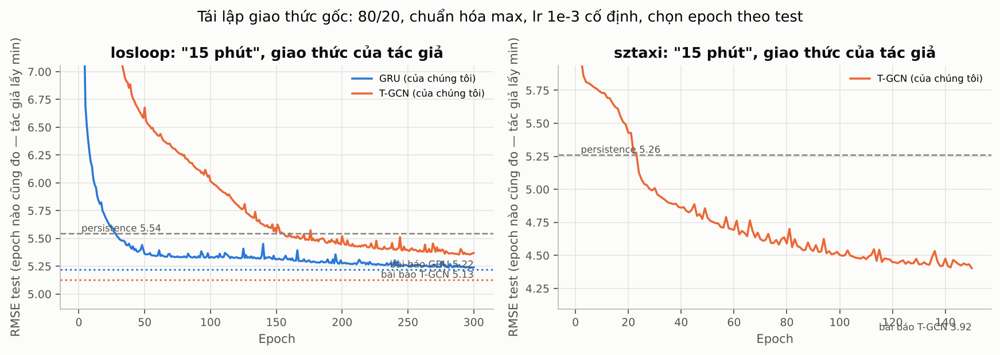

## 9. So sánh với bài báo

### 9.1 Cùng cách tính của bài báo ("15 phút" = trung bình các bước 1…k)

Los-loop, giao thức nghiêm ngặt của chúng tôi (chọn epoch bằng validation), so với Bảng 1 của Zhao et al. (chọn epoch bằng test). Mỗi ô: RMSE / MAE / Accuracy / R².

PAPER_TABLE

- **HA, GCN, GRU tái lập sát bài báo**; HA trung bình cửa sổ của chúng tôi gần như trùng HA của tác giả ở "15 phút" (7.49 / 3.97 so với 7.44 / 4.01), xác nhận cách hiểu "HA = trung bình 12 bước đầu vào".
- **Hồi quy tuyến tính của chúng tôi tốt hơn SVR của bài báo** (5.49 so với 6.01 ở 15 phút) — baseline của bài báo yếu hơn mức có thể đạt.
- **T-GCN của chúng tôi kém con số bài báo** (5.55 so với 5.13 ở 15 phút; 7.52 so với 7.27 ở 60 phút). Mục 9.2 kiểm tra xem bao nhiêu phần đến từ giao thức.
- **Mô hình cải tiến (ensemble GRU-RT) vượt mọi con số của bài báo**: "15 phút" 5.09 / 3.01 (bài báo T-GCN 5.13 / 3.18), "60 phút" 6.91 / 4.01 (7.27 / 4.60) — dưới giao thức chặt hơn và ít dữ liệu train hơn.

### 9.2 Tái lập đúng giao thức của tác giả

Chúng tôi chạy lại GRU và T-GCN theo **đúng giao thức trong mã của tác giả** (`--protocol paper`): chia 80/20 không có validation, chuẩn hóa chia cho max của toàn chuỗi, cửa sổ test nằm trọn trong 20% cuối, lr 10⁻³ cố định, batch 32, hidden 64 (Los-loop) / 100 (SZ-taxi), dự báo pre_len = 3 bước (Los-loop, "15 phút") và 1 bước (SZ-taxi), **giữ epoch có RMSE test nhỏ nhất**. Do giới hạn CPU, chúng tôi train 300 epoch (Los-loop) và 150 epoch (SZ-taxi) — 5–10% so với 3000 epoch của tác giả.

PAPER_PROTOCOL_TABLE



Nhận xét:

- **GRU tái lập được bài báo ngay cả với ít epoch** (bão hòa sớm). **T-GCN hội tụ rất chậm** dưới chuẩn hóa max và lr cố định: Los-loop 6.01 (epoch 100) → 5.52 (200) → 5.36 (300), vẫn đang giảm; với 3000 epoch có thể tiến tới con số 5.13 của bài báo. Chúng tôi không ngoại suy; điều chắc chắn là ở cùng ngân sách huấn luyện, T-GCN chưa vượt GRU.
- **Ngay cả dưới giao thức của tác giả, MAE của T-GCN (3.25) vẫn kém persistence (3.16)** trên đúng các cửa sổ test đó — điểm P4 không phụ thuộc vào cách chúng tôi huấn luyện.
- Trên SZ-taxi, GRU tái lập sát bài báo (4.10 / 2.74 so với 4.05 / 2.68) ngay từ những epoch đầu, còn T-GCN sau 150 epoch (4.40, epoch tốt nhất là epoch cuối) vẫn kém trung bình trượt 3 giờ trên cùng cửa sổ (4.17 / 2.74). Với chuỗi nhiễu như SZ-taxi, gần như toàn bộ "kỹ năng" mà bài báo báo cáo đạt được bằng một trung bình trượt (P6b).
- Giao thức nghiêm ngặt của chúng tôi (z-score theo train, lr cosine, dừng sớm bằng validation) cho T-GCN hội tụ trong ~100 epoch; đây là lý do chúng tôi dùng nó cho mọi so sánh chính.

### 9.3 Tóm tắt các giả thuyết

| Giả thuyết | Kết luận | Bằng chứng chính |
|---|---|---|
| H1 – Đồ thị có ích (T-GCN > GRU) | **Bác bỏ ở dạng gốc; đúng một phần sau khi sửa** | T-GCN ≈ GRU (p = 0.76), MAE kém hơn; đồ thị chỉ giúp ở tầm xa, biến động mạnh, dữ liệu nhiễu; dạng tách self/láng giềng thì tốt hơn GRU |
| H2 – Học sâu > baseline đơn giản | **Đúng tổng thể, sai ở giờ cao điểm** | Mọi mô hình vượt persistence (p < 0.005), nhưng trong cao điểm/kẹt xe persistence có MAE thấp nhất |
| H3 – Con số bài báo đáng tin | **Lạc quan** | Chọn epoch theo test, gộp tầm dự báo, không baseline persistence, không độ biến thiên |
| H4 – Có thể cải tiến | **Đúng** | Residual + thời gian (+ ensemble 3 seed): −7.8% RMSE so với GRU, −8.1% so với T-GCN, có ý nghĩa thống kê; tách self/láng giềng giúp T-GCN |

## 10. Kiểm chứng trên SZ-taxi

SZ_SECTION

## 11. Hạn chế và hướng phát triển

**Hạn chế của nghiên cứu này**

- Los-loop chỉ 7 ngày: tập test ~1.4 ngày; kết luận về giờ cao điểm dựa trên 3 đợt cao điểm. Cần lặp lại trên METR-LA đầy đủ (4 tháng, cùng 207 cảm biến) hoặc PEMS-BAY (bộ dữ liệu trong danh sách bài báo tham khảo).
- Huấn luyện trên CPU: ≤ 120 epoch với lịch học cosine thay vì 3000 epoch như tác giả; tinh chỉnh và một số biến thể chỉ có 1 seed.
- Không có dữ liệu sự kiện (tai nạn, thời tiết) — nguyên nhân của phần lớn sai số lớn trong giờ cao điểm.

**Hướng phát triển (theo thứ tự lợi ích kỳ vọng / chi phí)**

1. **Đưa vào sản phẩm ngay:** ensemble GRU-RT + bước kiểm tra dữ liệu thiếu (mô hình residual rất nhạy với đầu vào = 0) + cắt dự báo về [0, v_max].
2. **Tích chập đồ thị không làm loãng tín hiệu:** dạng [x, Âx]W đã cho kết quả tốt; bước tiếp theo là diffusion convolution hai chiều của DCRNN (Li et al., 2018 — bài báo thứ 2 trong danh sách tham khảo), phù hợp đồ thị có hướng như SZ-taxi.
3. **Hàm mất mát cho giờ cao điểm:** cân loss theo phương sai cảm biến chưa ổn định (mục 5.4); nên thử trọng số trực tiếp cho mẫu kẹt xe hoặc dự báo phân vị (quantile loss) để có khoảng dự báo đáng tin hơn trong cao điểm.
4. **Conformal theo giờ** để khoảng dự báo đạt độ phủ đúng cả trong giờ cao điểm.
5. **Dữ liệu dài hơn:** với ≥ 1 tháng dữ liệu, đặc trưng thời gian và đồ thị thích nghi có cơ hội phát huy (hiện bị quá khớp).

## 12. Kết luận

Chúng tôi đã cài đặt lại và chạy GRU, GCN, T-GCN cùng 4 baseline cổ điển trên Los-loop và SZ-taxi với cùng dữ liệu, cùng cách chia và 3 seed. **GRU tái lập đúng bài báo; T-GCN thì không vượt được GRU** một cách có ý nghĩa — chính Bảng 1 của bài báo cũng cho thấy MAE của GRU tốt hơn. Nguyên nhân cơ chế là phép chuẩn hóa D^(-1/2)(A+I)D^(-1/2) chỉ để lại ~30% trọng số cho tín hiệu của chính nút, làm hỏng dự báo tầm ngắn; bằng chứng đến từ ba hướng độc lập (thí nghiệm liều–đáp ứng với self-loop, permutation importance và gradient saliency). Con số của bài báo còn được "làm đẹp" bởi việc chọn epoch theo test và cách gộp tầm dự báo, và bài báo bỏ qua baseline persistence — baseline vốn tốt nhất trong giờ cao điểm. Cải tiến hiệu quả nhất không nằm ở đồ thị mà ở **cách đặt bài toán**: học phần thay đổi so với giá trị cuối (residual) và cho mô hình biết giờ trong ngày; ensemble 3 seed của GRU-RT giảm RMSE ~8% so với GRU/T-GCN (có ý nghĩa thống kê) và vượt mọi con số trong bài báo dù dùng giao thức chặt hơn. Đồ thị vẫn có giá trị — ở tầm xa, khi tốc độ biến động mạnh, khi dữ liệu nhiễu — nhưng chỉ khi được thiết kế để không xóa mờ thông tin riêng của từng nút.

## Phụ lục A. Cách chạy lại toàn bộ

```bash
pip install -r requirements.txt
python download_data.py --dataset losloop
python download_data.py --dataset sztaxi
python -m unittest discover -s tests -v                   # 8 test
python baselines.py --dataset losloop                     # naive, HA, linear
python baselines.py --dataset sztaxi
python run_suite.py --spec losloop:main losloop:improve losloop:variants losloop:tuning --jobs 4
python run_suite.py --spec losloop:paper sztaxi:paper sztaxi:main sztaxi:improve --jobs 4
python analysis/eda.py
python analysis/compare_models.py --dataset losloop      # bảng chính, ensemble, so sánh bài báo
python analysis/peak_hours.py --dataset losloop
python analysis/tuning_ablation.py --dataset losloop
python analysis/feature_importance.py --dataset losloop
python analysis/explain.py --dataset losloop
python analysis/reliability.py --dataset losloop
python tools/export_models.py                             # models/*.pt (chọn seed theo validation)
python tools/md2docx.py reports/BAO_CAO_TGCN.md reports/BAO_CAO_TGCN.docx
```

Thời gian: ≈ 15–45 phút/run trên 1 nhân CPU; toàn bộ ≈ 60 run ≈ 7–8 giờ với 4 nhân. Mọi run ghi `config.json`, `history.csv` (kèm RMSE test theo epoch chỉ để theo dõi), `metrics.json` (per-step, cumulative, Accuracy/R²/Var), `test_predictions.npz`, `best.pt`.

## Phụ lục B. Cấu trúc mã

| Tệp | Vai trò |
|---|---|
| `tgcn/data.py` | đọc CSV, chuẩn hóa theo train, Â đúng như mã tác giả, cửa sổ trượt, chế độ `--protocol paper` |
| `tgcn/models.py` | GRU, GCN, T-GCN (+ residual, thời gian, đồ thị thích nghi, tách self/láng giềng, Â = I) |
| `tgcn/training.py` | AdamW + cosine, dừng sớm theo validation, loss MSE/Huber/MAE, loss đơn vị gốc, mask số 0 |
| `tgcn/metrics.py` | MAE, RMSE, MAPE, WAPE, Accuracy, R², Var; per-step và cumulative |
| `baselines.py` | persistence, HA cửa sổ, HA theo giờ, hồi quy tuyến tính |
| `train.py`, `evaluate.py`, `predict.py` | huấn luyện một cấu hình; đánh giá checkpoint; nạp mô hình để dự báo |
| `run_suite.py` | toàn bộ thí nghiệm (tiếp tục được khi bị ngắt, chạy song song) |
| `analysis/*.py` | EDA, so sánh, giờ cao điểm, tinh chỉnh/ablation, ảnh hưởng thuộc tính, giải thích, độ tin cậy |
| `models/` | checkpoint cuối cùng dùng cho `predict.py` |

## Tài liệu tham khảo

1. L. Zhao et al., "T-GCN: A Temporal Graph Convolutional Network for Traffic Prediction," *IEEE T-ITS*, 2019. arXiv:1811.05320. Mã & dữ liệu: github.com/lehaifeng/T-GCN.
2. Y. Li, R. Yu, C. Shahabi, Y. Liu, "Diffusion Convolutional Recurrent Neural Network: Data-Driven Traffic Forecasting," *ICLR*, 2018. arXiv:1707.01926.
3. K. Cho et al., "Learning Phrase Representations using RNN Encoder–Decoder for Statistical Machine Translation" (GRU), *EMNLP*, 2014.
4. T. Kipf, M. Welling, "Semi-Supervised Classification with Graph Convolutional Networks," *ICLR*, 2017.
5. F. X. Diebold, R. S. Mariano, "Comparing Predictive Accuracy," *J. Business & Economic Statistics*, 1995.
6. V. Vovk, A. Gammerman, G. Shafer, *Algorithmic Learning in a Random World* (conformal prediction), 2005.
